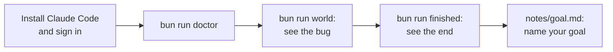
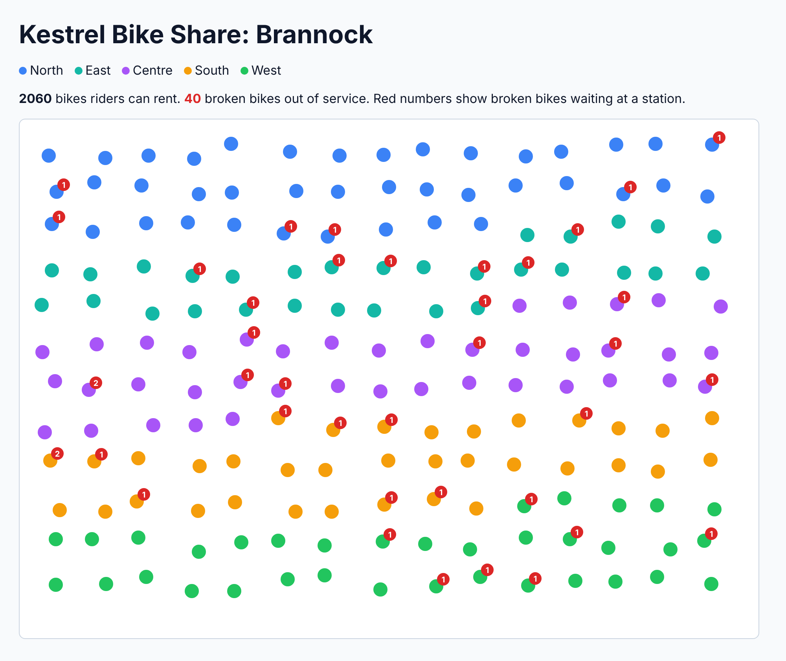
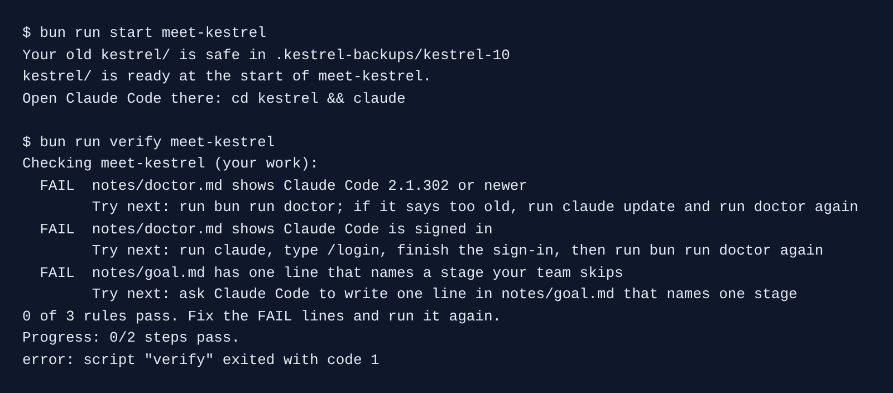

# Start here: meet Kestrel

In this part you get Claude Code ready, meet Kestrel's world, run the finished chain and name your goal. It fits in one short sitting.



## Get Claude Code

Claude Code is the tool you use for every step. Install it the official way, from the [setup page](https://code.claude.com/docs/en/setup.md). On macOS, Linux or WSL, the native installer is one line:

```bash
curl -fsSL https://claude.ai/install.sh | bash
```

Expect: the installer ends by printing where it put `claude`.

Then sign in. Run `claude`, type `/login` and follow the steps. A Claude plan or an API key for Claude Code both work. Then check the version:

```bash
claude --version
```

Expect: a version line that ends in `(Claude Code)`.

**No terminal habit?** You can use Claude Desktop instead. Download it, sign in, open the **Code** tab and pick the `kestrel` folder. Every prompt in this course works there too. You still type the `bun run` commands in a terminal, and each one has an `Expect:` line.

## Walkthrough

Make your own Kestrel repo. It goes in `kestrel/`, with its own git history:

```bash
bun run start meet-kestrel
```

Expect: `kestrel/ is ready at the start of meet-kestrel.`

Check that your machine is ready:

```bash
bun run doctor
```

Expect: `doctor: Claude Code 2.1.323, signed in, Bun 1.4.4, world ready`, with your own version numbers.

Start the world. Keep this terminal open:

```bash
bun run world
```

Expect: `spoke is running on http://localhost:4100`

Open http://localhost:4100. You see Brannock's 180 stations. A red number is how many broken bikes wait at a station.



In a second terminal, report a broken bike, the way a rider does with the wrench button:

```bash
bun run world wrench B-2207
```

Expect: `The public feed shows B-2207 with is_disabled: false.`

That is the bug. The rider said the bike is broken, and the public feed still offers it to the next rider. For example, the city contract in `kestrel/data/contract/sla.yaml` says the feed must be accurate "at all times".

Now see the end of the course. Stop the world with Ctrl+C first:

```bash
bun run finished --replay
```

Expect: `The finished chain holds: 11 gates, tests pass, world contract passes.`

See how far you are from the goal:

```bash
bun run scorecard
```

Expect: a line per step, then `Scorecard: 0 of 19 steps pass.` The count grows as you finish each step.

The scorecard runs the check of every step, so it is slow. Wait for the last line.

Now do the step: [meet-kestrel](meet-kestrel/problem/README.md).



When a command prints something you do not expect, look it up in [troubleshooting.md](troubleshooting.md).

## Watch and read

| Kind  | Title                                           | Author                                 | Why                                                                       | Link                                                               |
| ----- | ----------------------------------------------- | -------------------------------------- | ------------------------------------------------------------------------- | ------------------------------------------------------------------ |
| video | Claude Code best practices                      | Anthropic, talk at its developer event | The team shows CLAUDE.md, permissions, tools and planning in one sitting. | <https://www.youtube.com/watch?v=gv0WHhKelSE>                      |
| video | Claude Code and the evolution of agentic coding | Boris Cherny, who made Claude Code     | The maker explains plan mode and why the tool stays simple.               | <https://www.youtube.com/watch?v=Lue8K2jqfKk>                      |
| read  | Claude Code overview                            | Anthropic docs                         | The list of features this ladder climbs, from the makers.                 | <https://code.claude.com/docs/en/overview>                         |
| read  | Best practices for agentic coding               | Anthropic Engineering                  | The team's own advice on prompts, plans and checks.                       | <https://www.anthropic.com/engineering/claude-code-best-practices> |
| read  | Building effective agents                       | Anthropic Engineering                  | Explains when a plain workflow beats an agent.                            | <https://www.anthropic.com/engineering/building-effective-agents>  |
