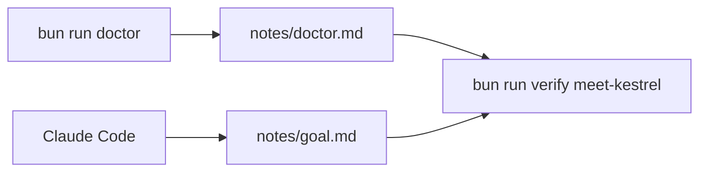
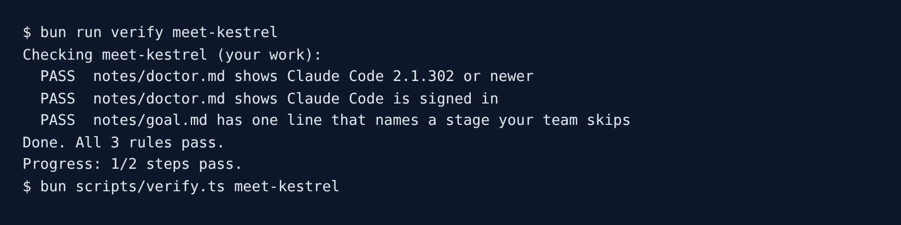

# Meet Kestrel

## The problem

Your team bought Claude Code for everyone. The engineers use it to write code. The plan, the spec, the review and the release are still done by hand, or skipped.

Before you change that, two things must be true. Your Claude Code must be new enough and signed in. And you must name the stage your own team skips today, so you know what this course is for.



## Your challenge

1. In the course folder, run `bun run doctor`. It saves its answer to `kestrel/notes/doctor.md`.
2. Open Claude Code in `kestrel/` and give it this job. Use your own team's answer.

```text
My team skips the Review stage today: we merge Claude's pull requests after a quick look.
Write that as exactly one line in notes/goal.md, with no heading.
```

Read the file Claude Code shows you before you say yes. For example, if it adds a heading or a second line, tell it to keep one line only.

## Done when

- `notes/doctor.md` shows a recent enough Claude Code.
- `notes/doctor.md` shows Claude Code is signed in.
- `notes/goal.md` has one line that names a stage: Plan, Design, Build, Review, Release or Maintain.

```bash
bun run verify meet-kestrel
```

Expect: `Done. All 3 rules pass.` Then `verify` checks every step of the course, to count your progress. This is slow. Wait for the `Progress:` line.



## If you get stuck

| What you see                                             | Fix                                                                    |
| -------------------------------------------------------- | ---------------------------------------------------------------------- |
| `FAIL notes/doctor.md shows a recent enough Claude Code` | Run `claude update`, then `bun run doctor` again.                      |
| `FAIL notes/doctor.md shows Claude Code is signed in`    | Run `claude`, type `/login`, then `bun run doctor` again.              |
| `FAIL notes/goal.md has one line that names a stage ...` | Ask Claude Code to keep one line and use one stage name from the list. |

## Words you will use

- **Stage**: one part of a feature's life. The six stages are Plan, Design, Build, Review, Release and Maintain.
- **Gate**: the point where a person reads a stage's file and approves it before the next stage starts.
- **Headless run**: Claude Code run with `claude -p`, with no chat window. The course records these runs so a check can read them.
