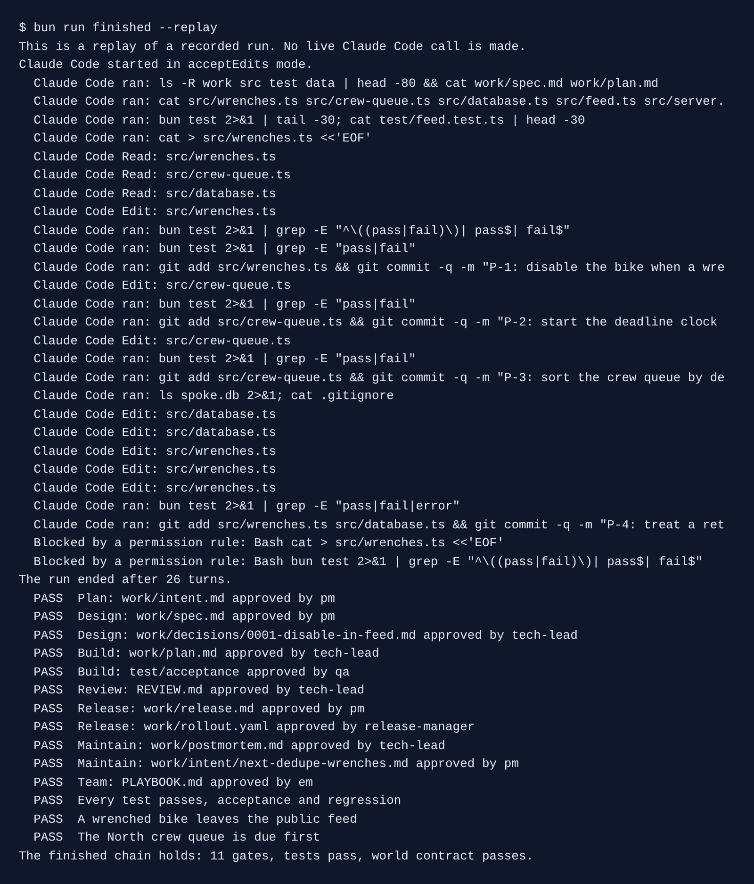
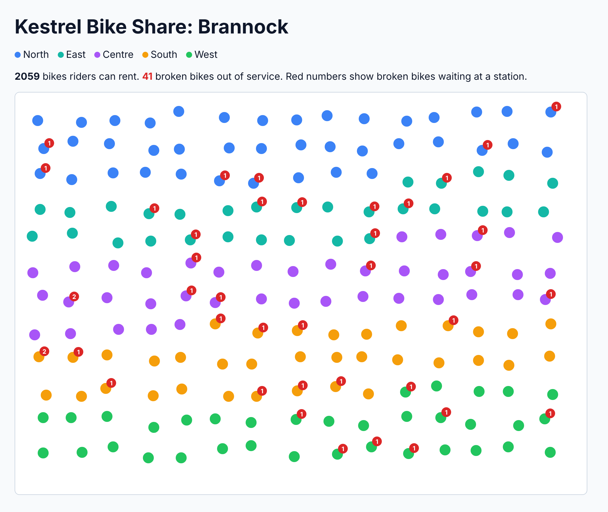
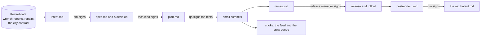

# One feature, idea to production, with Claude Code

You and your team carry one feature from a raw problem to production. Claude Code writes every stage. A person signs every gate. A script checks each file.

- **Objective:** you run every stage of a feature's life by prompting Claude Code. A person approves each gate. Each stage leaves one file that the next stage reads.
- **Outcome:** **the lifecycle chain**. It is a repo where one feature's intent, spec, decision, plan, tests, small commits, review, release note, rollout, postmortem, playbook and metrics link together. Each approval is stored with a hash of the file, so a late edit shows.
- **Transformation:** before, "we use Claude Code to write code, and the rest is the same, only slower to review." After, "we start from the problem. Claude Code writes every stage. We sign the gates, and git shows what changed."
- **Goal:** `bun run verify ship-the-feature` passes on your chain. Every acceptance criterion traces to a test, a small commit, the plan and the release note.

## Run the finished system

The finished system is the whole chain, done. Run it first, so you see where you are going.

```bash
bun install
```

Expect: `bun install` ends with no errors.

```bash
bun run finished
```

Expect: `The finished chain holds: 11 gates, tests pass, world contract passes.`

With Claude Code signed in, this makes a real run: Claude Code builds the approved plan on a fresh copy, and the checks read what it made. With no Claude Code, or in CI, it replays a recorded run and says so in its first line. To skip the live run, type `bun run finished --replay`.



For example, after the chain is done, a rider reports bike `B-2207` and it leaves the public map at once:



## The world and what you build

You work for **Kestrel Bike Share**, the bike share in the city of Brannock. Kestrel has 180 stations and 2,100 bikes. Its contract with the city says a bike a rider reports as broken must be fixed within 48 hours.

Today a reported bike stays on the public map, so the next rider takes it. Crews work the oldest job first, not the job that is due first. You fix this, one stage at a time.



Each box is one file that Claude Code writes. Each arrow is a gate. A person opens it with `bun run approve <file> --role <role>`.

## Who it is for

A product team that already has Claude Code and uses it mostly to write code.

| Role                | You leave able to                                                             |
| ------------------- | ----------------------------------------------------------------------------- |
| Engineering manager | Read the team's lifecycle numbers from git and write the team playbook        |
| Product manager     | Get Claude Code to turn a problem into an approved spec, without writing code |
| Tech lead           | Run plan mode against an approved spec and set rules a fresh reviewer follows |
| Engineer            | Build in small commits that each turn one approved test green                 |
| QA engineer         | Turn each acceptance criterion into a test that fails first                   |

You write no code in this course. You type prompts, read what Claude Code shows you, say yes or no, and steer.

## The parts

| Part                                                                  | Steps                                                                   | Minutes | What you leave with                                                   |
| --------------------------------------------------------------------- | ----------------------------------------------------------------------- | ------- | --------------------------------------------------------------------- |
| [Orientation](00-orientation/README.md)                               | `meet-kestrel`                                                          | 15      | Claude Code ready, the world running, your goal named                 |
| [Ready the repo](parts/01-ready-the-repo/README.md)                   | `ready-the-repo`                                                        | 20      | A short `CLAUDE.md`, `AGENTS.md` and settings that guard the contract |
| [Plan the change](parts/02-plan-the-change/README.md)                 | `find-the-real-problem`, `capture-the-intent`                           | 35      | `intent.md`, signed by the product manager                            |
| [Design the change](parts/03-design-the-change/README.md)             | `write-the-contract-skill`, `write-the-spec`, `record-the-decision`     | 55      | A skill, `spec.md` and a decision record                              |
| [Build the change](parts/04-build-the-change/README.md)               | `plan-in-plan-mode`, `write-the-failing-tests`, `build-in-small-slices` | 60      | `plan.md`, red tests, then small green commits                        |
| [Review the change](parts/05-review-the-change/README.md)             | `write-the-review-rules`, `review-with-fresh-eyes`                      | 30      | `REVIEW.md` and a reviewer that finds the planted bug                 |
| [Release the change](parts/06-release-the-change/README.md)           | `write-the-release-notes`, `gate-the-release`                           | 30      | Release notes and a rollout a person approves                         |
| [Learn from the incident](parts/07-learn-from-the-incident/README.md) | `write-the-postmortem`, `close-the-loop`                                | 40      | A blameless postmortem and the next intent                            |
| [Run the team](parts/08-run-the-team/README.md)                       | `measure-the-lifecycle`, `write-the-team-playbook`, `ship-the-feature`  | 50      | `metrics.md`, `PLAYBOOK.md` and the Goal check                        |

The same 335 minutes run as one workshop, four evenings or six sessions. See `schedules.toml`.

## How a step works

1. `bun run start <step-name>` puts your `kestrel/` repo at the start of the step.
2. You open Claude Code in `kestrel/` and give it the job in the step's README.
3. `bun run verify <step-name>` checks what Claude Code made. Each failed rule says what to try next.

For example, in `ready-the-repo` you ask Claude Code to deny edits to the city contract. Then `bun run record ready-the-repo` asks Claude Code to change the contract anyway. The check passes only when the deny rule stopped it.

If you fall behind, `bun run catch-up <step-name>` copies in the sample end state and says so.

## The project

You leave with two chains. The first is your Kestrel chain, where `ship-the-feature` passes. The second is the same stages on one small feature from your own team's backlog. Each is graded by yes or no questions, such as "was every acceptance test committed before the first code change?"

## Read before you start

- [The AI-native SDLC playbook](https://claude.com/resources/articles/the-ai-native-sdlc-playbook), Anthropic: the first two sections. This course is that playbook, done, with a check at every gate.
- [Announcing the 2025 DORA report](https://cloud.google.com/blog/products/ai-machine-learning/announcing-the-2025-dora-report), Google Cloud: why gates matter when AI raises throughput.
- [Best practices for Claude Code](https://code.claude.com/docs/en/best-practices.md), Anthropic: down to "Give Claude something it can run".

The rules this repo follows are in [STANDARD.md](STANDARD.md). The plan for the parts still being written is in [PARTS.md](PARTS.md).
