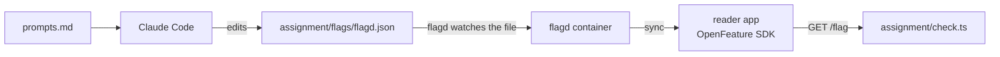

# Assignment: roll out one change to one district

Optional in the live session. Expected as homework. You do it next to the class while the hand-built rollout is taught.

## The task

In the release part you wrote `work/rollout.yaml` by hand. Its first stage is one district. Now a flag does the same job. flagd is a small server that serves flags from a file. OpenFeature is the standard way for code to ask for a flag.

Your job: change who sees `wrench_disables_bike` by editing one file, `assignment/flags/flagd.json`. You give the prompts. Claude Code makes the edit. The reader app is not touched.



## Steps

Start the two containers from the repo root:

```bash
docker compose -f assignment/compose.yml up -d
```

Expect: "Container assignment-reader-1 Started"

Ask the reader about a rider in North. The answer starts as `false`:

```bash
curl -s "localhost:8080/flag?user=u-100&district=North"
```

Expect: a line with `"value":false`

Ask Claude Code to edit `assignment/flags/flagd.json` so district North reads on and every other district reads off. Save your prompts in `assignment/prompts.md`. Then ask the reader again:

```bash
curl -s "localhost:8080/flag?user=u-100&district=North"
```

Expect: a line with `"value":true` within a few seconds, with no restart.

Run the check and stop the containers:

```bash
bun assignment/check.ts
```

Expect: `PASS` on both Done-when lines, and `assignment/result.json` written.

```bash
docker compose -f assignment/compose.yml down -v
```

Expect: "Container assignment-reader-1 Removed"

## Done when

- The flag reads off, then on, for a user in the group after the edit, with no restart.
- A user outside the group still reads off.

`bun run verify roll-out-with-openfeature` checks the same lines on your flag file without Docker.

## Rubric

A person reads these. There are no points.

- The group matches the rollout plan from class: the first district in `work/rollout.yaml`.
- `CHOICE.md` says when a flag UI is worth a server, with a Choose when line and a Trade-off line.
- `prompts.md` shows what you checked and what you rejected.

## Submit

Push a branch named `assignment` and send its URL. The grader runs `bun assignment/check.ts` again.
