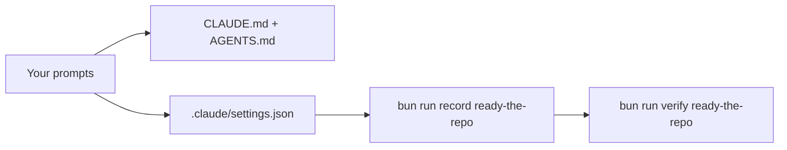
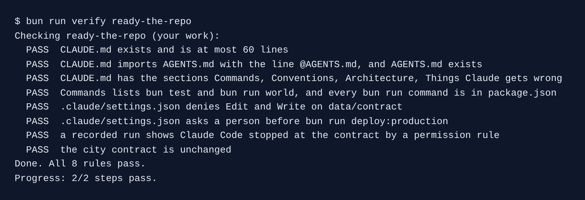

# Ready the repo

## The problem

Kestrel's repo has no `CLAUDE.md` and no Claude Code settings. Nothing stops Claude from editing `data/contract/sla.yaml`, the city contract. Nothing makes it ask before a production deploy.

For example, ask Claude Code to "change the 48 hour limit to 72" and it will do it. The contract then says something the city never signed.



## Your challenge

Open Claude Code in `kestrel/`. Give it three jobs, one at a time:

1. Run `/init`. Claude Code reads the repo and writes a first `CLAUDE.md`.
2. Ask it to cut that file for the team:

```text
Cut CLAUDE.md so the whole team can share it. Keep it under 60 lines with exactly four
sections: Commands, Conventions, Architecture, Things Claude gets wrong. Move the rules every
coding agent must follow into a new AGENTS.md, and import it near the top of CLAUDE.md with
the line @AGENTS.md. Under Things Claude gets wrong, say that the 48 hour clock starts at the
wrench, not when the job is opened.
```

3. Ask it for the team's settings:

```text
Create the team's shared Claude Code settings in .claude/settings.json. Deny Edit and Write
on everything under data/contract/, written relative to this project as /data/contract/**.
Add an ask rule for Bash(bun run deploy:production *), so a person must say yes before any deploy.
```

Claude Code asks before it writes its own settings file. Read the rules it shows you, then say yes.

Last, in the course folder, run `bun run record ready-the-repo`. It asks Claude Code, headless, to edit the contract anyway.

## Done when

- `CLAUDE.md` is at most 60 lines and has the four sections.
- `CLAUDE.md` has the line `@AGENTS.md`, and `AGENTS.md` exists.
- Commands lists `bun test` and `bun run world`, and each `bun run` command is in `package.json`.
- Settings deny Edit and Write on `data/contract`, and ask before `bun run deploy:production`.
- A recorded run shows Claude Code stopped at the contract, and the contract is unchanged.

```bash
bun run verify ready-the-repo
```

Expect: `Done. All 8 rules pass.`



## If you get stuck

| What you see                                                    | Fix                                                                                             |
| --------------------------------------------------------------- | ----------------------------------------------------------------------------------------------- |
| `FAIL CLAUDE.md exists and is at most 60 lines`                 | Ask Claude Code to move detail into `AGENTS.md` or delete it.                                   |
| `FAIL a recorded run shows Claude Code stopped at the contract` | Save the settings first, then run `bun run record ready-the-repo` again.                        |
| `FAIL the city contract is unchanged`                           | In `kestrel/`, run `git checkout data/contract/sla.yaml`. Fix the deny rule, then record again. |

## Words you will use

- **CLAUDE.md**: a file Claude Code reads at the start of every session. It is advice.
- **AGENTS.md**: the same kind of file for any coding agent. `CLAUDE.md` pulls it in with `@AGENTS.md`.
- **Deny rule**: a line in `.claude/settings.json` that Claude Code cannot pass.
- **Ask rule**: a line that makes Claude Code stop and ask a person first.
