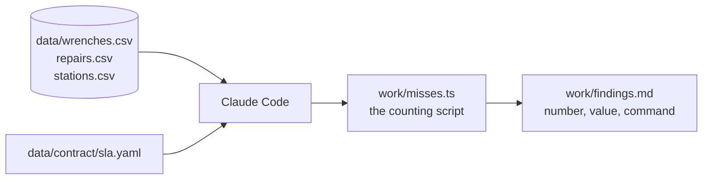
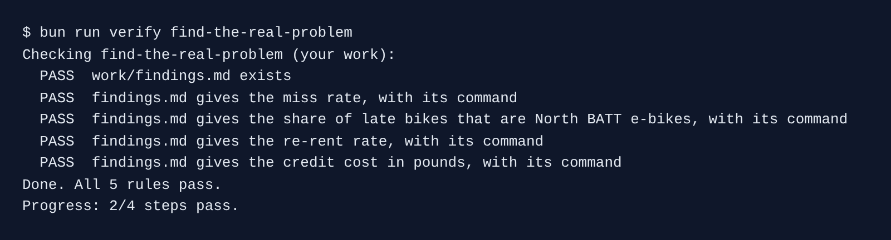

# Find the real problem

## The problem

Kestrel misses the 48 hour repair limit in the city contract. The operations lead wants two more crews. They cost money every month, and nobody knows where the misses happen.

The answer is already in `data/`. It holds 90 days of wrench reports and repair jobs. A **wrench** is a rider pressing the wrench button in the app to report a broken bike.

For example, one row of `data/wrenches.csv` reads `W-00001,B-2597,classic,S-036,2026-07-01T17:26:41Z,BRAKE,`. Bike `B-2597` had a brake fault at station `S-036`.



## Your challenge

Get Claude Code to find four numbers, and to prove each one with a command it ran. Start the step, then open Claude Code in `kestrel/`:

```bash
bun run start find-the-real-problem
```

Expect: `kestrel/ is ready at the start of find-the-real-problem.`

Give Claude Code this job:

```text
Operations wants two more repair crews because we miss the 48 hour repair limit. Before
anyone decides, find out where the misses happen.

Read data/wrenches.csv, data/repairs.csv, data/stations.csv and data/contract/sla.yaml.
Work out four numbers:
1. The miss rate: the share of wrenched bikes closed more than 48 hours after the wrench
   reported_at.
2. Of those late bikes, the share that are e-bikes with a BATT fault at stations served by
   the North depot.
3. The re-rent rate: the share of wrenched bikes rented again before a crew reached them.
4. What the late bikes cost in contract credits, in pounds.

Run a command for every number. Do not guess and do not estimate. Put the counting in one
small script, work/misses.ts, that a beginner can read: whole words for every name (never
r, w or pct), one idea per line, short functions, lines under 100 characters.

Write work/findings.md with a table: each number, its value as a count and a percentage,
and the exact command you ran to get it. Under the table, say in a few short lines what the
numbers mean for the request for more crews.
```

Claude Code asks before each command. Read it, then say yes. Say no to anything that changes `data/`.

## Done when

- `work/findings.md` exists.
- It gives the miss rate, the North battery share and the re-rent rate, each within 0.5 points of the check's own count.
- It gives the credit cost in pounds, within 50 pounds of the check's own count.
- Each of those numbers sits on a line with the command that made it, in backticks.

```bash
bun run verify find-the-real-problem
```

Expect: `Done. All 5 rules pass.`



## If you get stuck

| What you see                                             | Fix                                                                                         |
| -------------------------------------------------------- | ------------------------------------------------------------------------------------------- |
| `FAIL findings.md gives the miss rate, with its command` | Ask Claude Code to start the 48 hour clock at the wrench `reported_at`, not at `opened_at`. |
| `FAIL ... late bikes that are North BATT e-bikes ...`    | The depot is in `stations.csv`. Ask Claude Code to join on `station_id`.                    |
| `FAIL ... with its command`                              | Ask Claude Code to put the exact command in backticks in the same table row.                |

## Words you will use

- **Wrench**: a rider's report that a bike is broken. The contract clock starts here.
- **Miss rate**: the share of wrenched bikes fixed after the 48 hour limit.
- **Re-rent**: a rider took out a bike someone already reported as broken.
- **Credit**: 50 pounds Kestrel pays the city for each bike fixed late.
