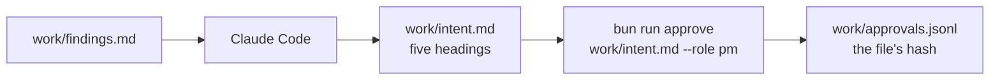
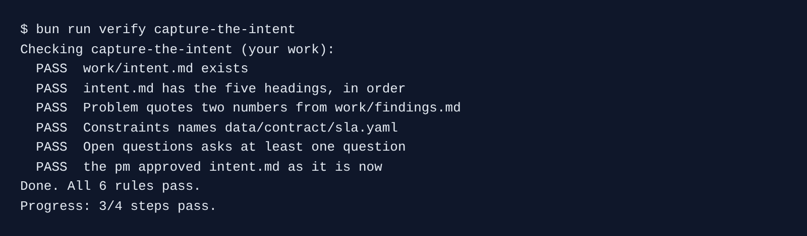

# Capture the intent

## The problem

You have the findings. Now the product manager must agree on what to change, before anyone writes a spec or code. If the team skips this, Claude Code builds the first idea in the room, and that idea was "more crews".

An **intent** is one page that says what should change and why, not how to build it. Anthropic's playbook uses five headings for it. A person signs it with `bun run approve`. That signature is the first gate in Kestrel's chain.

For example, a good Problem line reads "193 of 2,160 wrenched bikes (8.9%) were rented again before a crew reached them". The number comes straight from `work/findings.md`.



## Your challenge

Start the step. Your `kestrel/` gets the findings from the step before.

```bash
bun run start capture-the-intent
```

Expect: `kestrel/ is ready at the start of capture-the-intent.`

Open Claude Code in `kestrel/` and give it this job:

```text
Read work/findings.md. Write work/intent.md: the one-page intent for this change, for the
product manager to sign. Use exactly these five ## headings, in this order: Problem,
Proposed outcome, Affected users and systems, Constraints, Open questions.

Under Problem, quote at least two numbers from work/findings.md exactly as they are written
there. Under Constraints, name data/contract/sla.yaml and say it does not change. Operations
has also asked for a 15 minute grace period before a wrenched bike leaves the feed: put that
under Open questions, with anything else we do not know yet, each as a question. Say what
should change, not how to build it. No code.
```

Read `work/intent.md` as the product manager would. If a line names a file in `src/` or says how to code it, ask Claude Code to take it out. When you agree with every line, sign it yourself, from the course folder:

```bash
bun run approve work/intent.md --role pm
```

Expect: `Approved work/intent.md as pm`

Claude Code may not run `approve`. The script stops it, because a gate is a person's decision.

## Done when

- `work/intent.md` has the five headings, in order.
- Problem quotes at least two numbers that also appear in `work/findings.md`.
- Constraints names `data/contract/sla.yaml`.
- Open questions asks at least one question.
- The pm approval matches the file as it is now.

```bash
bun run verify capture-the-intent
```

Expect: `Done. All 6 rules pass.`



## If you get stuck

| What you see                                     | Fix                                                                         |
| ------------------------------------------------ | --------------------------------------------------------------------------- |
| `FAIL the pm approved intent.md as it is now`    | The file changed after you signed. Read it again, then run `approve` again. |
| `FAIL Problem quotes two numbers ...`            | Ask Claude Code to copy two numbers from `findings.md` as they are written. |
| `FAIL intent.md has the five headings, in order` | Ask Claude Code to use the five `##` headings and nothing in between.       |

## Words you will use

- **Intent**: one page that says what should change and why. It comes before the spec.
- **Gate**: a point where a person must say yes before the next stage starts.
- **Hash**: a short fingerprint of a file. If one letter changes, the hash changes, and the signature no longer counts.
