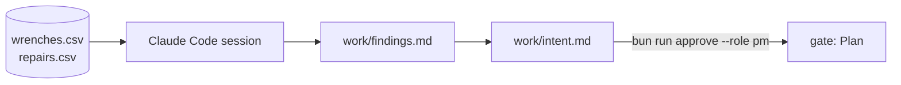

# Plan the change

This part moves the **Transformation**: from "Claude Code writes code" to "Claude Code starts at the problem".

## The problem

The operations lead asks for more crews. More crews cost money every month. The contract misses are real, but nobody has asked where they happen.

Kestrel's own data answers it. In 90 days, 118 of 2,160 wrenched bikes were fixed late, and 67 of those 118 were e-bike battery faults near the North depot.

At Anthropic, design and planning grew from 1.0% to 9.9% of Claude Code work in six months ([How AI is transforming work at Anthropic](https://www.anthropic.com/research/how-ai-is-transforming-work-at-anthropic)). Teams now use the agent before the code, not only for it.

For example, a good finding reads "67 of 118 late bikes are BATT e-bikes at North depot stations", with the query beside it.

| Step                    | Minutes | What the check reads                                                                                                                                                                                                                                                                                               |
| ----------------------- | ------- | ------------------------------------------------------------------------------------------------------------------------------------------------------------------------------------------------------------------------------------------------------------------------------------------------------------------ |
| `find-the-real-problem` | 20      | `work/findings.md`: the miss rate, the share of misses that are BATT e-bikes at North depot stations, the re-rent rate and the credit cost, each recomputed by the check from `data/` (within 0.5 points, or 50 pounds), each with the command Claude ran. `wrong/more-crews/` recommends hiring with no breakdown |
| `capture-the-intent`    | 15      | `work/intent.md` with Problem, Proposed outcome, Affected users and systems, Constraints, Open questions, in that order. Problem quotes two numbers from findings.md. Constraints names the contract file. `approvals.jsonl` has a `pm` line whose hash matches                                                    |

This part takes 35 minutes.

## Walkthrough

TODO(part session): one command per step, each followed by its `Expect:` line. Build each step's folder with `problem/`, `solution/` and `prompts.md`, and `wrong/`, as `parts/01-ready-the-repo/` does.
