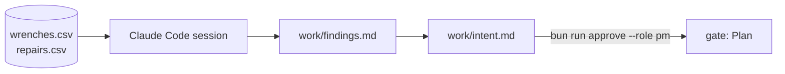

# Plan the change

This part moves the **Transformation**: from "Claude Code writes code" to "Claude Code starts at the problem".

## The problem

The operations lead asks for more crews. More crews cost money every month. The contract misses are real, but nobody has asked where they happen.

Kestrel's own data answers it. In 90 days, 118 of 2,160 wrenched bikes were fixed late, and 67 of those 118 were e-bike battery faults near the North depot.

At Anthropic, design and planning grew from 1.0% to 9.9% of Claude Code work in six months ([How AI is transforming work at Anthropic](https://www.anthropic.com/research/how-ai-is-transforming-work-at-anthropic)). Teams now use the agent before the code, not only for it.

For example, a good finding reads "67 of 118 late bikes are BATT e-bikes at North depot stations", with the query beside it.



| Step                    | Minutes | What the check reads                                                                                                                                                                                                                                                                                               |
| ----------------------- | ------- | ------------------------------------------------------------------------------------------------------------------------------------------------------------------------------------------------------------------------------------------------------------------------------------------------------------------ |
| `find-the-real-problem` | 20      | `work/findings.md`: the miss rate, the share of misses that are BATT e-bikes at North depot stations, the re-rent rate and the credit cost, each recomputed by the check from `data/` (within 0.5 points, or 50 pounds), each with the command Claude ran. `wrong/more-crews/` recommends hiring with no breakdown |
| `capture-the-intent`    | 15      | `work/intent.md` with Problem, Proposed outcome, Affected users and systems, Constraints, Open questions, in that order. Problem quotes two numbers from findings.md. Constraints names the contract file. `approvals.jsonl` has a `pm` line whose hash matches                                                    |

This part fits in one sitting.

## Walkthrough

Start the first step. It makes `kestrel/` with the repo you readied in Part 1.

```bash
bun run start find-the-real-problem
```

Expect: `kestrel/ is ready at the start of find-the-real-problem.`

Open Claude Code in `kestrel/` and give it the prompt in the step's README. When it is done, check the four numbers:

```bash
bun run verify find-the-real-problem
```

Expect: `Done. All 5 rules pass.`

Go on to the intent. The next step starts from the sample findings, so your numbers match the README.

```bash
bun run start capture-the-intent
```

Expect: `kestrel/ is ready at the start of capture-the-intent.`

Give Claude Code the intent prompt in the step's README. Read `work/intent.md`. Then sign it yourself:

```bash
bun run approve work/intent.md --role pm
```

Expect: `Approved work/intent.md as pm`

```bash
bun run verify capture-the-intent
```

Expect: `Done. All 6 rules pass.`

Last, check the whole part:

```bash
bun run verify part plan-the-change
```

Expect: `Part plan-the-change is done: 2/2 steps pass.`

For example, the passing table reads:

```text
Part plan-the-change:
  PASS   find-the-real-problem  (5/5 rules)
  PASS   capture-the-intent  (6/6 rules)
```

The part check reads your `kestrel/` as it is now. So `find-the-real-problem` passes too, because the findings are still there.

To see a sample end state instead, run `bun run catch-up capture-the-intent`.

## Assignment

Hand in your branch with `work/findings.md`, `work/intent.md` and the pm line in `work/approvals.jsonl`. The grader runs `bun run verify find-the-real-problem` and `bun run verify capture-the-intent`.

| #   | Question                                                                         | Answered by            |
| --- | -------------------------------------------------------------------------------- | ---------------------- |
| 1   | Does every number in `findings.md` sit beside the command that made it?          | the check              |
| 2   | Does `intent.md` quote at least two numbers from data the author names?          | the check and a reader |
| 3   | Does the pm approval match the file as it is now?                                | the check              |
| 4   | Does Proposed outcome say what changes for riders and crews, not how to code it? | a reader               |

Pass is 4 of 4.

**If you already know this:** write a second intent for station outages from the same data, in `work/intent/station-outages.md`. Then say which of the two to do first, with the one number that decides it.

## Finished

You now have the first stage of the chain: findings with a command for every number, and an intent the product manager signed. The answer is not "more crews". It is "take wrenched bikes out of the feed, and sort the queue by deadline".

In Part 3, Claude Code turns this intent into a spec. The open question about the 15-minute grace period comes back there, and the contract decides it.

## Watch and read

| Kind  | Title                                           | Author                             | Why                                                          | Link                                                                                |
| ----- | ----------------------------------------------- | ---------------------------------- | ------------------------------------------------------------ | ----------------------------------------------------------------------------------- |
| video | Claude Code and the evolution of agentic coding | Boris Cherny, who made Claude Code | The maker explains plan mode and why the tool stays simple.  | <https://www.youtube.com/watch?v=Lue8K2jqfKk>                                       |
| video | Claude Code best practices webinar              | Anthropic                          | Practical habits from the team that runs the tool every day. | <https://www.anthropic.com/webinars/claude-code-best-practices-lightspeed>          |
| read  | Common workflows                                | Anthropic docs                     | Plan mode, screenshots and files, step by step.              | <https://code.claude.com/docs/en/common-workflows>                                  |
| read  | Best practices for agentic coding               | Anthropic Engineering              | Explore, plan, then code, from the team.                     | <https://www.anthropic.com/engineering/claude-code-best-practices>                  |
| read  | Effective context engineering for AI agents     | Anthropic Engineering              | How to keep a fresh, small context.                          | <https://www.anthropic.com/engineering/effective-context-engineering-for-ai-agents> |
