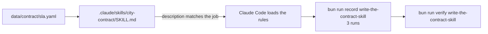
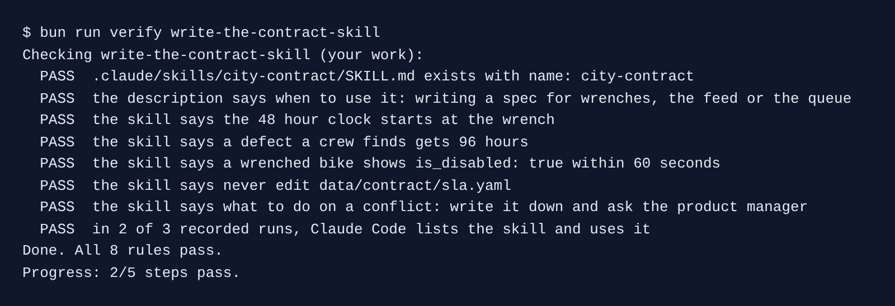

# Write the contract skill

## The problem

The city contract has four rules that touch this change. Claude Code follows them only if it reads them at the right moment. A long contract in `CLAUDE.md` crowds out everything else.

A **skill** is a folder with a `SKILL.md` file. Claude Code reads only its `description` at the start. It loads the rest when the job matches the description. So the description decides if the skill ever runs.

For example, a skill whose description is "Notes about data/contract/sla.yaml." was never loaded in 3 real runs that wrote a spec about wrenches. The same rules with "Use whenever you write a spec..." loaded in 3 of 3.



## Your challenge

Start the step. Your `kestrel/` has the signed intent from Part 2.

```bash
bun run start write-the-contract-skill
```

Expect: `kestrel/ is ready at the start of write-the-contract-skill.`

Open Claude Code in `kestrel/` and give it this job:

```text
Make a project skill for our contract with the city, in .claude/skills/city-contract/SKILL.md,
so every teammate's Claude Code applies it.

The frontmatter needs name: city-contract and a description that says when to use it:
whenever you write a spec, a plan, a test or code that touches wrench reports, the public
feed or the crew queue.

Read data/contract/sla.yaml, then write the body as a few short rules:
- the 48 hour clock starts at the wrench (the rider's reported_at), not when the job is opened
- a defect a crew finds itself gets 96 hours
- the public feed is accurate at all times: a wrenched bike shows is_disabled: true within
  60 seconds, so a grace period breaks the contract
- each late wrenched bike costs a 50 pound credit
- never edit data/contract/sla.yaml; if a request conflicts with the contract, do not build
  it, write the conflict down and ask the product manager
Keep it under 30 lines.
```

Claude Code asks before it writes inside `.claude/`. Read the rules it shows, then say yes.

Now prove the skill loads. From the course folder, run this three times. Each run asks Claude Code, headless, to draft a spec about wrenches:

```bash
bun run record write-the-contract-skill
```

Expect: `Claude Code Skill`

## Done when

- `SKILL.md` has `name: city-contract` and a description that names specs and wrenches, the feed or the queue.
- The body states the wrench clock, the 96 hour rule, the 60 second feed rule, the never-edit rule and what to do on a conflict.
- In 2 of 3 recorded runs, Claude Code lists the skill and uses it.

```bash
bun run verify write-the-contract-skill
```

Expect: `Done. All 8 rules pass.`



## If you get stuck

| What you see                                   | Fix                                                                                                        |
| ---------------------------------------------- | ---------------------------------------------------------------------------------------------------------- |
| `FAIL the description says when to use it ...` | Ask Claude Code to start the description with "Use whenever you write a spec".                             |
| `FAIL in 2 of 3 recorded runs ...`             | Fix the description first. Delete `kestrel/recordings/write-the-contract-skill/`, then record three times. |

## Words you will use

- **Skill**: a `SKILL.md` file Claude Code loads when the job matches its description.
- **Frontmatter**: the lines between the two `---` lines at the top. They hold `name` and `description`.
- **Recorded run**: a real, headless Claude Code run saved as lines of JSON, so a check can read what Claude did.
