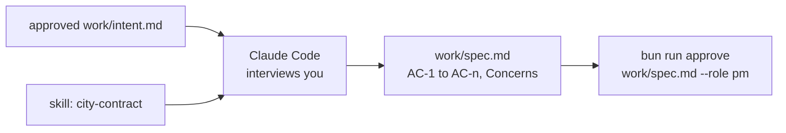
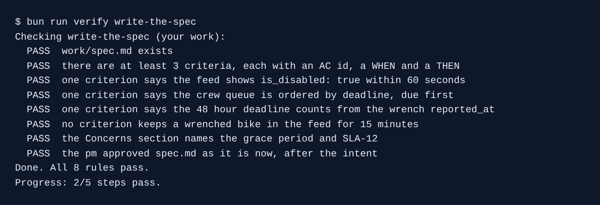

# Write the spec

## The problem

The intent says what should change. The spec says how anyone can tell it is done. Each line of a spec is an **acceptance criterion**: one WHEN, one THEN, and a number or a field name a test can check.

Operations still wants a 15-minute grace period before a wrenched bike leaves the feed. The contract says the feed is accurate "at all times" (SLA-12). A spec that quietly builds the grace period gets shipped, and Kestrel breaks its contract.

For example, "WHEN a rider sends `POST /wrench` THEN `vehicle_status.json` shows `is_disabled: true` within 60 seconds" is a line a test can check. "The feed is quick" is not.



## Your challenge

Start the step. Your `kestrel/` has the signed intent and the contract skill.

```bash
bun run start write-the-spec
```

Expect: `kestrel/ is ready at the start of write-the-spec.`

Open Claude Code in `kestrel/`. You play the product manager. First ask it to interview you:

```text
Read work/intent.md. Interview me, one question at a time, until you could write the spec.
```

Answer from the intent's open questions. Operations still wants the 15-minute grace period. Station counts must change too. Crews want the job due first on top. Open jobs should follow the contract from launch. Then ask for the spec:

```text
Write work/spec.md from the approved work/intent.md and my answers. Use the city-contract
skill. Write acceptance criteria with ids AC-1, AC-2 and so on. Give each one a WHEN line and
a THEN line, and put a number or a field name in every THEN line. Add a ## Concerns section for
anything the spec cannot do as asked: name the contract clause and who owns the decision.
No code.
```

Read every criterion. Check that the grace period is in Concerns, not in a criterion. Then sign it:

```bash
bun run approve work/spec.md --role pm
```

Expect: `Approved work/spec.md as pm`

## Done when

- At least 3 criteria, each with an id like `AC-1`, a WHEN and a THEN.
- One criterion: the feed shows `is_disabled: true` within 60 seconds.
- One criterion: the queue is ordered by deadline. One: the deadline is `reported_at` plus 48 hours.
- No criterion keeps the bike in the feed for a 15-minute grace period. Concerns names the grace period and SLA-12.
- The pm approval matches the file, and comes after the intent's.

```bash
bun run verify write-the-spec
```

Expect: `Done. All 8 rules pass.`



## If you get stuck

| What you see                                                    | Fix                                                                        |
| --------------------------------------------------------------- | -------------------------------------------------------------------------- |
| `FAIL one criterion says the crew queue is ordered by deadline` | "Oldest first" is not the same. Ask for "sorted by `deadline`, due first". |
| `FAIL the Concerns section names the grace period and SLA-12`   | Ask Claude Code to use the heading `## Concerns`, exactly.                 |
| `FAIL the pm approved spec.md as it is now, after the intent`   | The spec changed after you signed. Read it, then approve again.            |

## Words you will use

- **Acceptance criterion**: one checkable line, WHEN this happens THEN that is true.
- **Concern**: something the spec cannot do as asked, with the clause and the owner.
- **SLA-12**: the contract line that says the public feed is accurate at all times.
