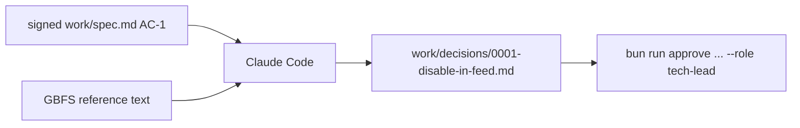
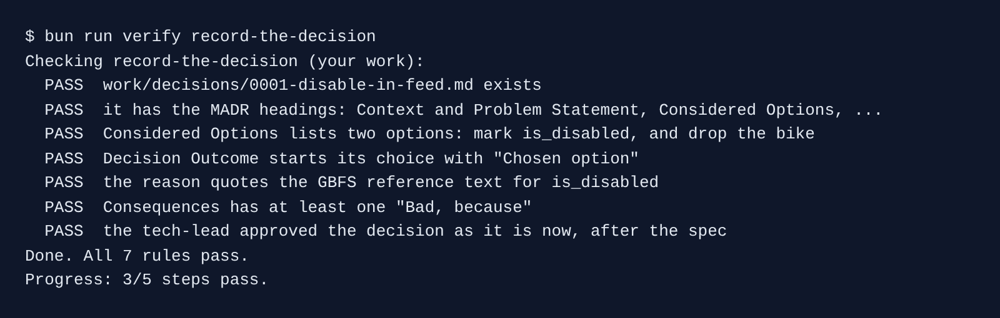

# Record the decision

## The problem

AC-1 says a wrenched bike must stop looking rentable. The GBFS feed allows two ways to do it. You can keep the bike in the feed and mark it `is_disabled: true`. Or you can drop it from the feed until it is fixed.

Both work for riders on Kestrel's own app. They do not work the same for other apps that read the public feed. If nobody writes down why the team chose one, someone will change it in six months and break those apps.

An **architecture decision record**, or ADR, is a short file that says what was chosen and why. MADR is a common shape for one.

For example, the GBFS reference says `is_disabled` marks bikes "not available for rental due to a mechanical issue". That sentence is the reason for the choice.



## Your challenge

Start the step:

```bash
bun run start record-the-decision
```

Expect: `kestrel/ is ready at the start of record-the-decision.`

Open the GBFS reference at `https://github.com/MobilityData/gbfs/blob/v3.0/gbfs.md` and find `is_disabled`. Then give Claude Code this job, with the text you found:

```text
Record the design decision behind AC-1 in work/spec.md as an architecture decision record:
work/decisions/0001-disable-in-feed.md, in the MADR minimal shape with these ## headings:
Context and Problem Statement, Considered Options, Decision Outcome, Consequences.

Consider two options: mark the bike is_disabled in vehicle_status.json, or drop the bike from
the feed until it is fixed. Here is the GBFS v3 reference text for is_disabled, copied from
https://github.com/MobilityData/gbfs/blob/v3.0/gbfs.md:
"This field is used to indicate vehicles that are in the field but not available for rental
due to a mechanical issue or low battery etc. Publishing this data may prevent users from
attempting to rent vehicles that are disabled and not available for rental."

Quote it exactly in the reason. Start the outcome with "Chosen option:". Under Consequences,
write at least one "Good, because" and one "Bad, because". Keep it under 40 lines. No code.
```

Read the record as the tech lead. Then sign it:

```bash
bun run approve work/decisions/0001-disable-in-feed.md --role tech-lead
```

Expect: `Approved work/decisions/0001-disable-in-feed.md as tech-lead`

## Done when

- The record has the four MADR headings.
- Considered Options lists both options.
- Decision Outcome says "Chosen option" and quotes the GBFS text.
- Consequences has at least one "Bad, because".
- The tech-lead approval matches the file, and comes after the spec's.

```bash
bun run verify record-the-decision
```

Expect: `Done. All 7 rules pass.`



## If you get stuck

| What you see                                                     | Fix                                                                            |
| ---------------------------------------------------------------- | ------------------------------------------------------------------------------ |
| `FAIL the reason quotes the GBFS reference text for is_disabled` | Claude Code wrote the quote from memory. Paste the real text into your prompt. |
| `FAIL Considered Options lists two options ...`                  | Ask Claude Code to list both options, even the one it does not pick.           |
| `FAIL the tech-lead approved the decision ... after the spec`    | Approve the spec first, then the decision.                                     |

## Words you will use

- **ADR**: a short file that records one decision, the options and why.
- **MADR**: a common ADR shape with four headings.
- **GBFS**: the open standard for public bike-share feeds. `vehicle_status.json` is one of its files.
