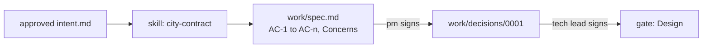

# Design the change

This part moves the **Objective**: a spec Claude Code can build from and a person can sign.

## The problem

The operations lead wants a 15-minute grace period before a wrenched bike leaves the feed, to stop false reports. The contract says the feed must be accurate "at all times". A spec that misses this gets built, shipped and fined.

The contract shape comes from a real one. A Citi Bike monthly report to New York City shows bike defects fixed in time 92.33% of the time ([Citi Bike monthly report](https://mot-marketing-whitelabel-prod.s3.us-east-1.amazonaws.com/nyc/April-2026-Citi-Bike-Monthly-Report.pdf)).

For example, the spec line "WHEN a rider sends POST /wrench THEN vehicle_status.json shows is_disabled: true within 60 seconds" is one a test can check.



| Step                       | Minutes | What the check reads                                                                                                                                                                                                                                                                                                             |
| -------------------------- | ------- | -------------------------------------------------------------------------------------------------------------------------------------------------------------------------------------------------------------------------------------------------------------------------------------------------------------------------------- |
| `write-the-contract-skill` | 15      | `.claude/skills/city-contract/SKILL.md`: frontmatter `name` and a `description` that says when to use it; the body states the clock starts at the wrench, the 96 hour rule, feed accuracy and the never-edit rule. In 2 of 3 recorded runs the init line lists the skill and the run uses it                                     |
| `write-the-spec`           | 25      | `work/spec.md`: every criterion has an id, a WHEN line and a THEN line. One says `is_disabled: true` within 60 seconds, one says the queue is ordered by deadline. Concerns names the grace period and SLA-12. The pm approval matches and comes after the intent. `wrong/keep-it-short/` sorts the queue oldest first and fails |
| `record-the-decision`      | 15      | `work/decisions/0001-disable-in-feed.md` in MADR shape with two options, one chosen, a reason that cites the GBFS `is_disabled` text, and one "Bad, because". The tech-lead approval comes after the spec approval                                                                                                               |

This part fits in one sitting.

## Walkthrough

Start the first step. It makes `kestrel/` with the signed intent from Part 2.

```bash
bun run start write-the-contract-skill
```

Expect: `kestrel/ is ready at the start of write-the-contract-skill.`

Give Claude Code the skill prompt in the step's README. Then prove the skill loads. Run this three times:

```bash
bun run record write-the-contract-skill
```

Expect: `Claude Code Skill`

```bash
bun run verify write-the-contract-skill
```

Expect: `Done. All 8 rules pass.`

Go on to the spec:

```bash
bun run start write-the-spec
```

Expect: `kestrel/ is ready at the start of write-the-spec.`

Let Claude Code interview you, then ask for `work/spec.md`, as the step's README shows. Read it, then sign it:

```bash
bun run approve work/spec.md --role pm
```

Expect: `Approved work/spec.md as pm`

```bash
bun run verify write-the-spec
```

Expect: `Done. All 8 rules pass.`

Last, the decision record:

```bash
bun run start record-the-decision
```

Expect: `kestrel/ is ready at the start of record-the-decision.`

Paste the GBFS text into your prompt, as the step's README shows. Read the record, then sign it as the tech lead:

```bash
bun run approve work/decisions/0001-disable-in-feed.md --role tech-lead
```

Expect: `Approved work/decisions/0001-disable-in-feed.md as tech-lead`

```bash
bun run verify record-the-decision
```

Expect: `Done. All 7 rules pass.`

Check the whole part:

```bash
bun run verify part design-the-change
```

Expect: `Part design-the-change is done: 3/3 steps pass.`

For example, the passing table reads:

```text
Part design-the-change:
  PASS   write-the-contract-skill  (8/8 rules)
  PASS   write-the-spec  (8/8 rules)
  PASS   record-the-decision  (7/7 rules)
```

Each `start` gives you the sample end of the step before. To see a sample end state instead, run `bun run catch-up record-the-decision`.

## Assignment

Hand in your branch with the skill, its three recorded runs, `work/spec.md`, the decision record and their lines in `work/approvals.jsonl`. The grader runs `bun run verify part design-the-change`.

| #   | Question                                                                  | Answered by            |
| --- | ------------------------------------------------------------------------- | ---------------------- |
| 1   | Does the skill load in 2 of 3 recorded runs?                              | the check              |
| 2   | Does every acceptance criterion have an id, a WHEN line and a THEN line?  | the check              |
| 3   | Does the spec name the grace period conflict, its clause and its owner?   | the check and a reader |
| 4   | Does the decision quote the GBFS text, word for word?                     | the check and a reader |
| 5   | Did each approval come after the one before it, and still match its file? | the check              |

Pass is 5 of 5.

**If you already know this:** prove the skill loads in 3 of 3 runs phrased three different ways. Change the prompt in your local `config/claude-code.ts` between runs, and say in one line which wording came closest to missing.

## Finished

You now have the design stage of the chain: a contract skill that loads when it should, a spec of checkable criteria that says no to the grace period, and a signed decision record. The product manager and the tech lead have each signed.

In Part 4, Claude Code plans the build from this spec in plan mode. Then it writes one failing test per criterion, and builds the change in small slices.

## Watch and read

| Kind  | Title                                 | Author                                 | Why                                                                       | Link                                                                                          |
| ----- | ------------------------------------- | -------------------------------------- | ------------------------------------------------------------------------- | --------------------------------------------------------------------------------------------- |
| video | Claude Code advanced patterns webinar | Anthropic                              | Subagents and hooks for work that runs in many steps.                     | <https://www.anthropic.com/webinars/claude-code-advanced-patterns>                            |
| video | Claude Code best practices            | Anthropic, talk at its developer event | The team shows CLAUDE.md, permissions, tools and planning in one sitting. | <https://www.youtube.com/watch?v=gv0WHhKelSE>                                                 |
| read  | Agent Skills                          | Anthropic docs                         | How a skill is written, found and used.                                   | <https://code.claude.com/docs/en/skills>                                                      |
| read  | Equipping agents with Agent Skills    | Anthropic Engineering                  | Why a skill beats a long prompt.                                          | <https://www.anthropic.com/engineering/equipping-agents-for-the-real-world-with-agent-skills> |
| read  | Writing tools for agents              | Anthropic Engineering                  | What makes a tool easy for a model to use.                                | <https://www.anthropic.com/engineering/writing-tools-for-agents>                              |
