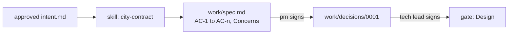

# Design the change

This part moves the **Objective**: a spec Claude Code can build from and a person can sign.

## The problem

The operations lead wants a 15 minute grace period before a wrenched bike leaves the feed, to stop false reports. The contract says the feed must be accurate "at all times". A spec that misses this gets built, shipped and fined.

The contract shape comes from a real one. Citi Bike's April 2026 report to New York City shows bike defects fixed in time 92.33% of the time ([Citi Bike monthly report](https://mot-marketing-whitelabel-prod.s3.us-east-1.amazonaws.com/nyc/April-2026-Citi-Bike-Monthly-Report.pdf)).

For example, the spec line "WHEN a rider sends POST /wrench THEN vehicle_status.json shows is_disabled: true within 60 seconds" is one a test can check.

| Step                       | Minutes | What the check reads                                                                                                                                                                                                                                                                                                     |
| -------------------------- | ------- | ------------------------------------------------------------------------------------------------------------------------------------------------------------------------------------------------------------------------------------------------------------------------------------------------------------------------ |
| `write-the-contract-skill` | 15      | `.claude/skills/city-contract/SKILL.md`: frontmatter `name` and a `description` that says when to use it; the body states the clock starts at the wrench, the 96 hour rule, feed accuracy and the never-edit rule. In 2 of 3 recorded runs the init line lists the skill and the run uses it                             |
| `write-the-spec`           | 25      | `work/spec.md`: every criterion has an id, a WHEN line and a THEN line. One says `is_disabled: true` within 60 seconds, one says the queue is ordered by deadline. Concerns names the grace period and SLA-12. The pm approval matches and comes after the intent. `wrong/grace-period/` adopts the 15 minutes and fails |
| `record-the-decision`      | 15      | `work/decisions/0001-disable-in-feed.md` in MADR shape with two options, one chosen, a reason that cites the GBFS `is_disabled` text, and one "Bad, because". The tech-lead approval comes after the spec approval                                                                                                       |

This part takes 55 minutes.

## Walkthrough

TODO(part session): one command per step, each followed by its `Expect:` line. Build each step's folder with `problem/`, `solution/` and `prompts.md`, and `wrong/`, as `parts/01-ready-the-repo/` does.
