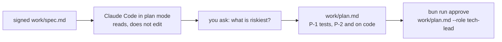
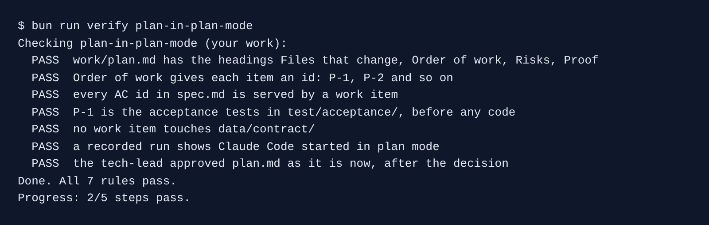

# Plan in plan mode

## The problem

Ask Claude Code to "build the spec" and it starts editing at once. You see the plan only as a diff, after the work is done.

**Plan mode** is a Claude Code mode where it may read and think, but not change files. It shows you a plan and waits. You read it, push back, and only then say yes.

For example, in plan mode Claude Code found that the job id `J-${Date.now()}` can repeat when two wrenches come in the same millisecond. It planned the fix before any code changed.



## Your challenge

Start the step:

```bash
bun run start plan-in-plan-mode
```

Expect: `kestrel/ is ready at the start of plan-in-plan-mode.`

Open Claude Code in `kestrel/`. Press Shift+Tab until the status line says plan mode. Then give it this job:

```text
Plan how to build the approved work/spec.md. Read the spec, the decision in work/decisions/
and the code first.

The plan needs four ## headings: Files that change, Order of work, Risks, Proof.
Under Order of work, give each work item an id (P-1, P-2 and so on) and name the AC ids it
serves. Every AC id in the spec must be served by an item.
P-1 is the acceptance tests only: one test file per AC id in test/acceptance/, named for its
id. They are committed before any change to src/, and they fail where the code is wrong today.
The items after P-1 change src/. Keep each one small enough for one commit under 200 lines.
Nothing may touch data/contract/.
Under Risks, say which item is riskiest and what it could break.
```

Read the plan. Ask one hard question first, for example "Which item could break `POST /wrench`?". Then accept the plan and ask:

```text
Save the plan you showed me to work/plan.md word for word. Do not change any other file.
```

Then sign it, and record a plan mode run for the check:

```bash
bun run approve work/plan.md --role tech-lead
```

Expect: `Approved work/plan.md as tech-lead`

```bash
bun run record plan-in-plan-mode
```

Expect: `Claude Code started in plan mode.`

## Done when

- `work/plan.md` has the four headings, and items with ids `P-1`, `P-2` and so on.
- Every AC id in the spec is served by an item. P-1 is the tests in `test/acceptance/`.
- No item touches `data/contract/`.
- A recorded run started in plan mode.
- The tech-lead approval matches the file and comes after the decision's.

```bash
bun run verify plan-in-plan-mode
```

Expect: `Done. All 7 rules pass.`



## If you get stuck

| What you see                                                 | Fix                                                                         |
| ------------------------------------------------------------ | --------------------------------------------------------------------------- |
| `FAIL a recorded run shows Claude Code started in plan mode` | Run `bun run record plan-in-plan-mode`. It starts Claude Code in plan mode. |
| `FAIL P-1 is the acceptance tests in test/acceptance/ ...`   | Ask Claude Code to move every test into P-1, before any code item.          |
| `FAIL every AC id in spec.md is served by a work item`       | Ask Claude Code which AC ids no item names.                                 |

## Words you will use

- **Plan mode**: Claude Code reads and plans, but changes no file until you accept.
- **Work item**: one small piece of the plan, such as `P-2`, that fits in one commit.
