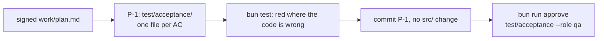
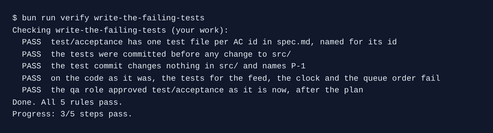

# Write the failing tests

## The problem

A test written after the code often checks what the code does, not what the spec asks. It passes on day one and proves nothing. A test written first, and seen to fail, proves the bug was real.

So item P-1 of the plan is the tests alone. Claude Code writes one test file per criterion, runs them, and commits them before any change to `src/`. Then the qa role signs them. After that signature, nobody may change a test to make it pass.

For example, `ac-1-wrench-disables-bike.test.ts` wrenches bike `B-1000` and expects `is_disabled: true`. On today's code it fails, because `recordWrench` never sets the flag.



## Your challenge

Start the step. This `kestrel/` has git history, so the check can see what came first.

```bash
bun run start write-the-failing-tests
```

Expect: `kestrel/ is ready at the start of write-the-failing-tests.`

Open Claude Code in `kestrel/` and give it this job:

```text
Build item P-1 of the approved work/plan.md, and nothing else: the acceptance tests in
test/acceptance/, one test file per AC id in work/spec.md, each named for its id. Do not
change anything in src/.

Run bun test test/acceptance and show me which tests fail today. The tests for behaviour the
code gets wrong must fail; the guard tests may pass. Then commit only test/acceptance/ with a
message that starts with "P-1:".
```

Read the list of red and green tests. A test for AC-1, AC-8 or AC-9 that passes today checks nothing, so reject it. Then sign the tests as qa:

```bash
bun run approve test/acceptance --role qa
```

Expect: `Approved test/acceptance as qa`

## Done when

- `test/acceptance/` has one test file per AC id, named for its id.
- The tests were committed before any change to `src/`, in a commit that names `P-1`.
- On the code as it was, the tests for the feed, the clock and the queue order fail.
- The qa approval matches the tests and comes after the plan's.

```bash
bun run verify write-the-failing-tests
```

Expect: `Done. All 5 rules pass.`



## If you get stuck

| What you see                                              | Fix                                                                        |
| --------------------------------------------------------- | -------------------------------------------------------------------------- |
| `FAIL the tests were committed before any change to src/` | Run `bun run start write-the-failing-tests` again, and commit tests first. |
| `FAIL on the code as it was, the tests ... fail`          | A test passes on broken code. Ask Claude Code what it really checks.       |
| Claude Code will not commit red tests                     | Say that red is expected for P-1, and that the build items come next.      |

## Words you will use

- **Acceptance test**: a test for one acceptance criterion, named for its id.
- **Red and green**: a failing test is red, a passing one is green.
- **Guard test**: a test that passes today and must keep passing, so the change breaks nothing.
