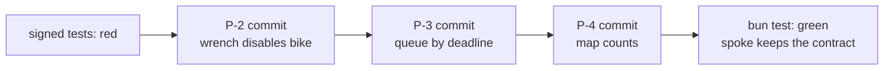
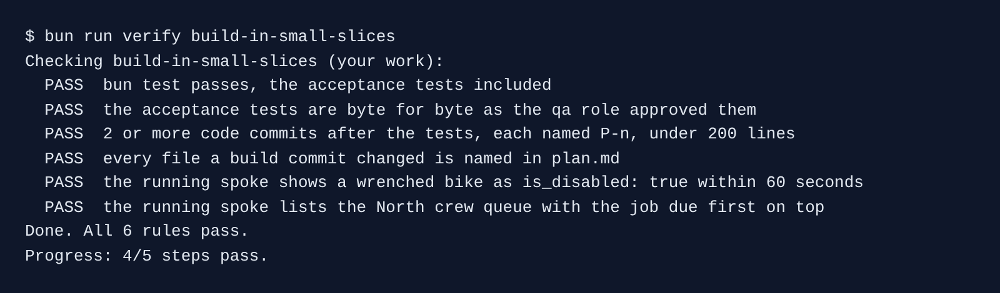
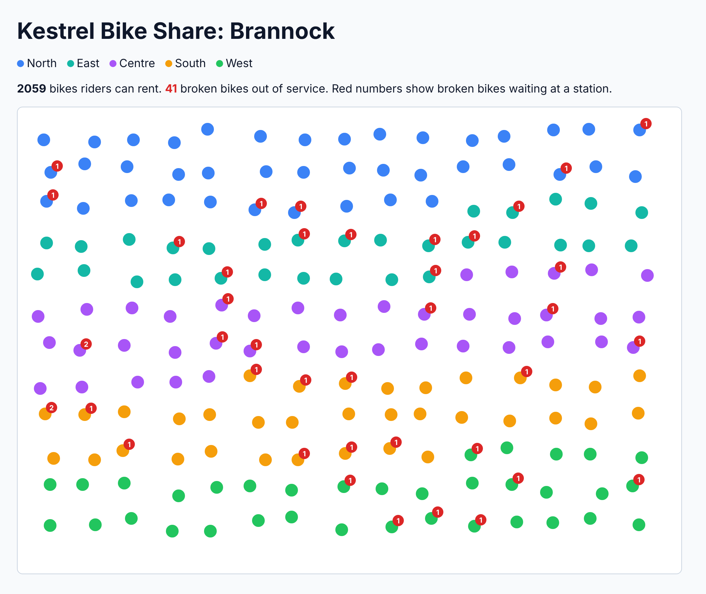

# Build in small slices

## The problem

Last month one pull request was 1,400 lines. Review took two days, and a line nobody read caused an incident. Small commits fix this. Each one does one plan item, so a reviewer reads it in minutes.

Now the tests are signed and red. Claude Code builds the rest of the plan, one item per commit, and runs the tests after each one. It may not change a signed test.

For example, the sample build is four commits. `P-2` changes 27 lines in `src/wrenches.ts`. `P-3` changes 15 lines in `src/crew-queue.ts`.



## Your challenge

Start the step:

```bash
bun run start build-in-small-slices
```

Expect: `kestrel/ is ready at the start of build-in-small-slices.`

Open Claude Code in `kestrel/`. You can let it accept edits (Shift+Tab), because each commit stops for you to read. Give it this job:

```text
Build the rest of the approved work/plan.md, one item at a time, starting at P-2. Read
work/spec.md first. Make the acceptance tests in test/acceptance pass without changing them:
the qa role signed them. Never touch data/contract/.

After each item, run bun test. Then commit that item on its own, with a message that starts
with its plan id, for example "P-2: ...". Keep every commit under 200 changed lines. Stop and
tell me if an item needs a file the plan does not list.
```

After each commit, read the diff with `git show` in `kestrel/`. Say no if Claude Code changes a file in `test/acceptance/`.

## Done when

- `bun test` passes, the acceptance tests included.
- The acceptance tests are byte for byte as the qa role signed them.
- 2 or more code commits after the tests, each naming a plan item and under 200 changed lines.
- Every file a build commit changed is named in `plan.md`.
- The running service shows a wrenched bike as `is_disabled: true` within 60 seconds, and the North queue is due first.

```bash
bun run verify build-in-small-slices
```

Expect: `Done. All 6 rules pass.`



After one wrench on bike `B-2207`, the map counts 41 broken bikes out of service, not 40:



## If you get stuck

| What you see                                                  | Fix                                                                        |
| ------------------------------------------------------------- | -------------------------------------------------------------------------- |
| `FAIL the acceptance tests are byte for byte as ... approved` | In `kestrel/`, run `git log --oneline`. Copy the id of `approve: test/acceptance by qa`. Run `git checkout <that id> -- test/acceptance`. |
| `FAIL 2 or more code commits after the tests ...`             | Ask Claude Code to commit one item at a time, not all at once.             |
| `FAIL bun test passes ...`                                    | Ask Claude Code which plan item is not built yet.                          |

## Words you will use

- **Slice**: one plan item, built and committed on its own.
- **Diff**: the lines a commit adds and removes. `git show` prints it.
- **World contract**: what the running service must do for riders and crews. The check asks it over HTTP.
