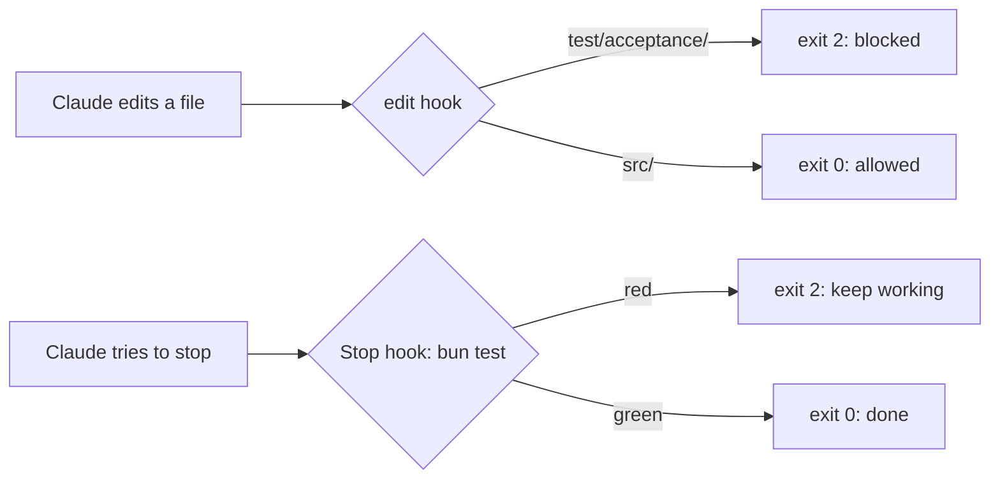

# Fence the signed tests

## The problem

The qa role signed the tests. A signature only helps if nothing can change them later. At 2 a.m. Claude Code may "fix" a red test by editing it, and nobody is awake to say no.

A hook is a command Claude Code runs by itself at a set moment. Exit code 2 means "block this, and tell Claude why".

For example, a hook that exits 2 for any file in `test/acceptance/` makes the signed tests read-only for Claude Code.



## Your challenge

Start the step. Your `kestrel/` has the signed tests:

```bash
bun run start fence-the-signed-tests
```

Expect: `kestrel/ is ready at the start of fence-the-signed-tests.`

Open Claude Code in `kestrel/` and give it this job:

```text
Add two hooks to .claude/settings.json. First, a PreToolUse hook for Edit, Write and
MultiEdit that exits 2 with a short message when the file is in test/acceptance/, and exits 0
for any other file. Second, a Stop hook that runs bun test and exits 2 while a test is red, so
you cannot stop until they pass. If stop_hook_active is true, exit 0. Keep our deny and ask rules.
```

Read `.claude/settings.json` and both hook files before you accept them. The edit hook must let `src/` through, or Claude Code cannot build anything. The Stop hook will keep Claude Code working through the next steps until `bun test` is green. That is the point.

```bash
bun run verify fence-the-signed-tests
```

Expect: `Done. All 4 rules pass.`

## Done when

- `settings.json` registers an edit hook and a Stop hook.
- The edit hook exits 2 for a file in `test/acceptance/` and 0 for a file in `src/`.
- The Stop hook exits 2 on a red test and 0 on a green one.

## If you get stuck

| What you see                     | Fix                                                                        |
| -------------------------------- | -------------------------------------------------------------------------- |
| "FAIL the edit hook exits 0 ..." | The hook blocks too much. Ask Claude Code to let every path but the tests. |
| "FAIL the Stop hook exits 2 ..." | Run the hook by hand with a red test and read its exit code.               |

## Words you will use

- **Hook**: a command Claude Code runs by itself at a set moment, such as before an edit.
- **Stop hook**: a hook that runs when Claude thinks it is done. It can send Claude back to work.
