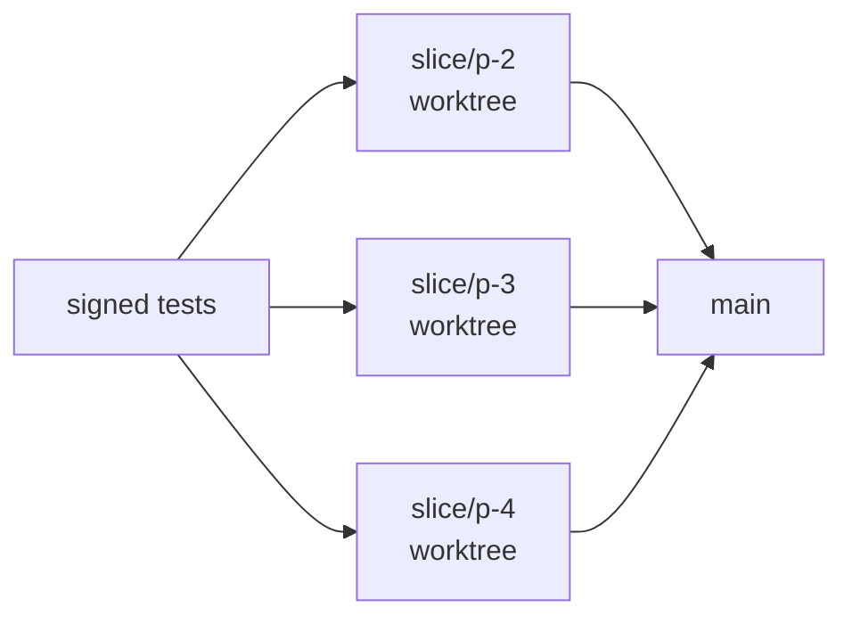

# Build in parallel

## The problem

Three plan items touch three different files, so they do not have to wait for each other. Built one by one, a day of work takes a day. Built side by side, it takes the longest one.

Claude Code can give each item its own copy of the repo, called a worktree, on its own branch. The three sessions cannot overwrite each other.

For example, P-2 changes `src/wrenches.ts`, P-3 changes `src/crew-queue.ts`, and P-4 changes `src/map-page.ts`. No two share a file.



## Your challenge

Start the step. Your `kestrel/` has the signed tests and the plan:

```bash
bun run start build-in-parallel
```

Expect: `kestrel/ is ready at the start of build-in-parallel.`

Open a terminal for each of P-2, P-3 and P-4. In each, start Claude Code in its own worktree:

```bash
claude -w slice/p-2
```

Expect: Claude Code opens on a new branch named `slice/p-2`. Do the same with `slice/p-3` and `slice/p-4`.

Give each session its one plan item, and say what it may not touch:

```text
Build only plan item P-2 from work/plan.md. Make its acceptance tests pass. Do not change
test/acceptance/ or any file the plan does not list for P-2. Run bun test, then commit with a
message that starts with "P-2:".
```

When a slice is done, merge it from `kestrel/`:

```bash
git merge --no-ff slice/p-2 -m "Merge slice/p-2"
```

Expect: git names the merge and the one file the slice changed.

Last, read each build commit with `git show --numstat`. Write one line for each in `work/slices.md`, such as `- P-2: 27 lines`. The number proves you read the diff.

```bash
bun run verify build-in-parallel
```

Expect: `Done. All 5 rules pass.`

## Done when

- `bun test` passes, and the signed tests are unchanged.
- Two or more slices were merged from `slice/` branches that touch different files.
- `work/slices.md` gives the changed lines of each build commit, and git agrees.
- Each build commit is small, names a plan item, and stays inside the plan.

## If you get stuck

| What you see                  | Fix                                                                   |
| ----------------------------- | --------------------------------------------------------------------- |
| "FAIL two or more slices ..." | Two branches changed the same file. Split the work, or merge in turn. |
| "FAIL work/slices.md ..."     | Run `git show --numstat` on the commit and copy its two numbers.      |

## Words you will use

- **Worktree**: a second copy of the repo on its own branch, so two sessions can work at once.
- **Slice**: one plan item, built and committed on its own.
