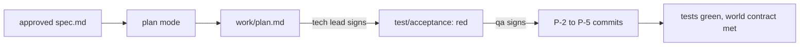

# Build the change

This part moves the **Objective** and the **Transformation**: from one big AI diff to small slices a person can review.

## The problem

Last month an engineer let Claude write the whole queue rewrite in one go. The pull request was 1,400 lines. Review took two days, and the incident that followed came from a line nobody read.

DORA's guide to its AI capabilities model says: "AI can easily generate massive blocks of code, which are hard to review and test. Enforcing the discipline of small batches counteracts this risk." ([DORA, from adoption to impact](https://cloud.google.com/blog/products/ai-machine-learning/from-adoption-to-impact-putting-the-dora-ai-capabilities-model-to-work)).

For example, the sample build is four commits after the tests, `P-2` to `P-5`. The largest changes 27 lines.



| Step                      | Minutes | What the check reads                                                                                                                                                                                                                                                                                                                                            |
| ------------------------- | ------- | --------------------------------------------------------------------------------------------------------------------------------------------------------------------------------------------------------------------------------------------------------------------------------------------------------------------------------------------------------------- |
| `plan-in-plan-mode`       | 20      | `work/plan.md` with Files that change, Order of work, Risks, Proof. Every AC id appears in a work item. No item touches `data/contract/`. The recorded session's init line has `permissionMode` `plan`. The tech-lead approval comes after the decision approval                                                                                                |
| `write-the-failing-tests` | 15      | One test per AC id in `test/acceptance/`, named for its id. Every test fails on the begin state. The test commit is earlier in git than any change to `src/`. The qa approval of `test/acceptance` matches                                                                                                                                                      |
| `build-in-small-slices`   | 25      | All tests pass. At least 2 commits after the test commit, none over 200 changed lines, each naming a plan item. The acceptance tests are byte for byte as approved. The world contract: `POST /wrench` then the feed shows `is_disabled: true` within 60 seconds, and `GET /crew/queue` is due first. `wrong/edited-the-test/` and `wrong/one-big-commit/` fail |

This part fits in one sitting.

## Walkthrough

Start the first step. It makes `kestrel/` with the signed spec and decision from Part 3.

```bash
bun run start plan-in-plan-mode
```

Expect: `kestrel/ is ready at the start of plan-in-plan-mode.`

In Claude Code, switch to plan mode with Shift+Tab and give it the plan prompt in the step's README. Accept the plan, ask Claude Code to save it, then sign it and record a plan mode run:

```bash
bun run approve work/plan.md --role tech-lead
```

Expect: `Approved work/plan.md as tech-lead`

```bash
bun run record plan-in-plan-mode
```

Expect: `Claude Code started in plan mode.`

```bash
bun run verify plan-in-plan-mode
```

Expect: `Done. All 7 rules pass.`

Next, the failing tests. This begin state has git history:

```bash
bun run start write-the-failing-tests
```

Expect: `kestrel/ is ready at the start of write-the-failing-tests.`

Give Claude Code the P-1 prompt. Check which tests are red, then sign them as qa:

```bash
bun run approve test/acceptance --role qa
```

Expect: `Approved test/acceptance as qa`

```bash
bun run verify write-the-failing-tests
```

Expect: `Done. All 5 rules pass.`

Last, the build:

```bash
bun run start build-in-small-slices
```

Expect: `kestrel/ is ready at the start of build-in-small-slices.`

Give Claude Code the build prompt. Read each commit as it lands. Then check:

```bash
bun run verify build-in-small-slices
```

Expect: `Done. All 6 rules pass.`

Check the whole part:

```bash
bun run verify part build-the-change
```

Expect: `Part build-the-change is done: 3/3 steps pass.`

For example, the passing table reads:

```text
Part build-the-change:
  PASS   plan-in-plan-mode  (7/7 rules)
  PASS   write-the-failing-tests  (5/5 rules)
  PASS   build-in-small-slices  (6/6 rules)
```

The checks run the tests and start the real service, so `verify part` takes about half a minute. To see a sample end state instead, run `bun run catch-up build-in-small-slices`.

## Assignment

Hand in your branch with `work/plan.md`, `test/acceptance/`, the commits and their lines in `work/approvals.jsonl`. The grader runs `bun run verify part build-the-change`.

| #   | Question                                                                            | Answered by |
| --- | ----------------------------------------------------------------------------------- | ----------- |
| 1   | Did a plan mode run come before the plan, and does every AC have a work item?       | the check   |
| 2   | Were the tests committed before the first source change, and red where it mattered? | the check   |
| 3   | Were the tests never edited after the qa approval?                                  | the check   |
| 4   | Is every build commit at or under 200 changed lines, and named for a plan item?     | the check   |
| 5   | Does each commit message say what the item does, so a reviewer can read the log?    | a reader    |

Pass is 5 of 5.

**If you already know this:** run P-2 and P-3 in two Claude Code sessions at once, each in its own git worktree. Merge both, and keep each commit under the limit.

## Finished

You now have the build stage of the chain. You have a plan made in plan mode, and tests that were red before the code and are green after. You also have four small commits a reviewer can read one at a time. The running service keeps the contract: a wrenched bike leaves the feed, and the crew queue puts the job due first on top.

In Part 5, a reviewer with read-only tools checks the change with fresh eyes, against the team's own review rules.

## Watch and read

| Kind  | Title                                 | Author         | Why                                                   | Link                                                               |
| ----- | ------------------------------------- | -------------- | ----------------------------------------------------- | ------------------------------------------------------------------ |
| video | Claude Code advanced workshop         | Anthropic      | A hands-on session on running several agents at once. | <https://www.anthropic.com/webinars/claude-code-workshop-advanced> |
| video | Claude Code advanced patterns webinar | Anthropic      | Subagents and hooks for work that runs in many steps. | <https://www.anthropic.com/webinars/claude-code-advanced-patterns> |
| read  | Hooks                                 | Anthropic docs | How a hook blocks an action with an exit code.        | <https://code.claude.com/docs/en/hooks>                            |
| read  | Checkpointing                         | Anthropic docs | How to rewind a change you do not want.               | <https://code.claude.com/docs/en/checkpointing>                    |
| read  | Common workflows                      | Anthropic docs | Parallel sessions with git worktrees.                 | <https://code.claude.com/docs/en/common-workflows>                 |
