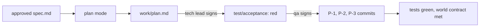

# Build the change

This part moves the **Objective** and the **Transformation**: from one big AI diff to small slices a person can review.

## The problem

Last month an engineer let Claude write the whole queue rewrite in one go. The pull request was 1,400 lines. Review took two days, and the incident that followed came from a line nobody read.

DORA's guide to its AI capabilities model says: "AI can easily generate massive blocks of code, which are hard to review and test. Enforcing the discipline of small batches counteracts this risk." ([DORA, from adoption to impact](https://cloud.google.com/blog/products/ai-machine-learning/from-adoption-to-impact-putting-the-dora-ai-capabilities-model-to-work)).

For example, the finished chain's build is four commits: `P-1` to `P-4`, the largest 28 changed lines.

| Step                      | Minutes | What the check reads                                                                                                                                                                                                                                                                                                                                            |
| ------------------------- | ------- | --------------------------------------------------------------------------------------------------------------------------------------------------------------------------------------------------------------------------------------------------------------------------------------------------------------------------------------------------------------- |
| `plan-in-plan-mode`       | 20      | `work/plan.md` with Files that change, Order of work, Risks, Proof. Every AC id appears in a work item. No item touches `data/contract/`. The recorded session's init line has `permissionMode` `plan`. The tech-lead approval comes after the decision approval                                                                                                |
| `write-the-failing-tests` | 15      | One test per AC id in `test/acceptance/`, named for its id. Every test fails on the begin state. The test commit is earlier in git than any change to `src/`. The qa approval of `test/acceptance` matches                                                                                                                                                      |
| `build-in-small-slices`   | 25      | All tests pass. At least 2 commits after the test commit, none over 200 changed lines, each naming a plan item. The acceptance tests are byte for byte as approved. The world contract: `POST /wrench` then the feed shows `is_disabled: true` within 60 seconds, and `GET /crew/queue` is due first. `wrong/edited-the-test/` and `wrong/one-big-commit/` fail |

This part takes 60 minutes.

## Walkthrough

TODO(part session): one command per step, each followed by its `Expect:` line. Build each step's folder with `problem/`, `solution/` and `prompts.md`, and `wrong/`, as `parts/01-ready-the-repo/` does.
