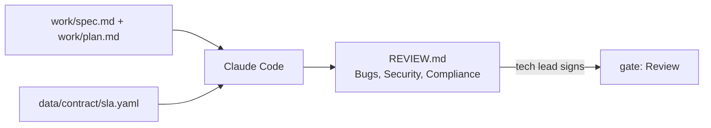

# Write the review rules

## The problem

Kestrel's build is done. The tests are green and the plan is approved. Now someone has to review the change, and soon Claude Code will review it too.

A reviewer with no rules comments on everything. The one comment that matters, "this deadline is an hour late", hides in a pile of comments about names. People stop reading reviews like that.

For example, ask Claude Code "write a REVIEW.md with code review guidelines". In a real run it wrote seven sections of checklists. It had no cap on nits, no meaning for Important, and no list of what to leave out.



## Your challenge

Start the step, then open Claude Code in `kestrel/`:

```bash
bun run start write-the-review-rules
```

Expect: `kestrel/ is ready at the start of write-the-review-rules.`

Give Claude Code this job. It reads the spec, the plan and the contract, then writes `REVIEW.md`:

```text
Write REVIEW.md at the root of this repo: the rules a reviewer follows on every change to
Kestrel. Read work/spec.md, work/plan.md and data/contract/sla.yaml first. Use one ## section
for each of the three passes: Bugs, Security, Compliance. Under Compliance, say to check the
change against work/spec.md and work/plan.md. Add a section called What Important means here:
a finding is Important only when riders, crews or the city contract would feel it, with one
example from Kestrel. Add a section called Nits that allows at most 3 nits per review. Add a
section called Do not report that lists data/ (recorded data, not code) and formatting. Add a
section called How to write a finding: one table row per finding with the columns Pass,
Severity, Where, What goes wrong, Criterion, where Severity is Important or Nit. Keep the file
under 40 lines.
```

Read the file. Does the Important example come from Kestrel? Then sign it as the tech lead, in the course folder:

```bash
bun run approve REVIEW.md --role tech-lead
```

Expect: `Approved REVIEW.md as tech-lead`

## Run the same rules on every pull request

A rules file that only runs on your laptop is easy to forget. The same file can run on every pull request, so a review lands before a person opens the page. Claude Code has a headless mode for this. It reads `REVIEW.md` from the repo, so the rules you just signed are the rules the robot follows.

Try it by hand first, in your repo, on Sam's branch:

```bash
git diff main...origin/teammate/local-deadlines | claude -p "Review this diff with the rules in REVIEW.md. Answer with the findings table only."
```

Expect: a findings table with the five columns from `REVIEW.md`. In our run the first row was an Important finding in `src/crew-queue.ts` about the clock change, with SLA-4 and AC-8 as the criteria. Wording changes from run to run, and there are never more than 3 Nit rows.

In CI the job does the same thing. This is a sketch to copy into your own repo, so the course does not ship it as a workflow file:

```yaml
name: review
on: pull_request
jobs:
  review:
    runs-on: ubuntu-latest
    permissions: { contents: read, pull-requests: write }
    steps:
      - uses: actions/checkout@v4
        with: { fetch-depth: 0 }
      - run: npm install -g @anthropic-ai/claude-code
      - run: git diff origin/${{ github.base_ref }}...HEAD | claude -p "Review this diff with the rules in REVIEW.md." > review.md
        env: { ANTHROPIC_API_KEY: "${{ secrets.ANTHROPIC_API_KEY }}" }
      - run: gh pr comment ${{ github.event.pull_request.number }} --body-file review.md
        env: { GH_TOKEN: "${{ github.token }}" }
```

Keep the key in a secret, and let the job comment only. It must never push, approve or merge. A person still decides.

## Done when

- `REVIEW.md` has a heading for each pass: Bugs, Security, Compliance.
- Compliance names `work/spec.md` and `work/plan.md`.
- It says what Important means, caps nits with a number, and its Do not report list names `data/`.
- The tech lead approved `REVIEW.md` as it is now, after QA approved `test/acceptance`.

```bash
bun run verify write-the-review-rules
```

Expect: `Done. All 8 rules pass.`

## If you get stuck

| What you see                                         | Fix                                                                                    |
| ---------------------------------------------------- | -------------------------------------------------------------------------------------- |
| `FAIL REVIEW.md caps nits with a number`             | "Keep nits few" is not a cap. Ask for "at most 3 nits per review".                     |
| `FAIL the tech lead approved REVIEW.md as it is now` | The file changed after you signed it. Read it again, then approve it again.            |
| `Only a person can approve`                          | You ran approve inside Claude Code. Run it in your own terminal, in the course folder. |

## Words you will use

- **Pass**: one reading of the change with one question. Bugs: is it wrong? Security: can someone abuse it? Compliance: does it match the spec and plan?
- **Important**: a finding that riders, crews or the city contract would feel. It must be fixed before release.
- **Nit**: a small point, such as a stale comment. Nice to fix, never a blocker.
