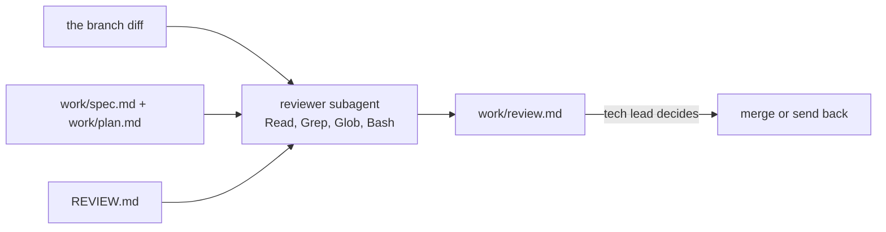
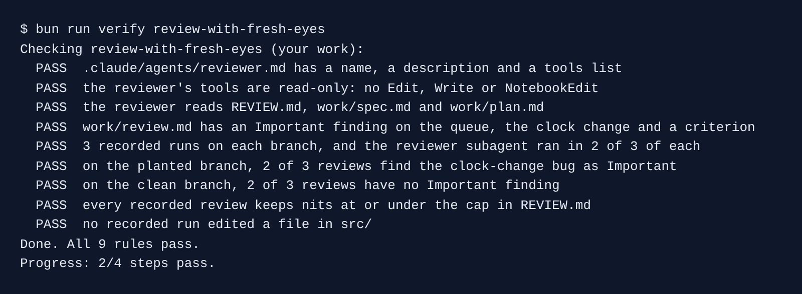

# Review with fresh eyes

## The problem

Sam's branch `teammate/local-deadlines` shows crews each deadline in Brannock time. Every test passes. But it adds the 48 hours on the wall clock, not in real time.

For example, a bike is wrenched at noon, one night before the clocks go back. The branch gives it a deadline 49 real hours later. The bike is late, and the city charges 50 pounds.

The session that wrote a change is a poor judge of it. A **subagent** starts fresh, with only the diff, spec, plan and `REVIEW.md`. A second branch, `teammate/deadline-labels`, does the same job safely. A good reviewer finds the bug on the first and stays quiet on the second.



## Your challenge

Start the step and open Claude Code in `kestrel/`:

```bash
bun run start review-with-fresh-eyes
```

Expect: `kestrel/ is ready at the start of review-with-fresh-eyes.`

First, ask Claude Code for the reviewer:

```text
Create a project subagent in .claude/agents/reviewer.md. In its frontmatter: name reviewer;
a description that says to use it to review a branch against work/spec.md, work/plan.md and
REVIEW.md before the tech lead decides; and tools: Read, Grep, Glob, Bash. Give it no Edit and
no Write tool, because a reviewer never changes the code. In the body, tell it: you review a
change you did not write. Read REVIEW.md, work/spec.md and work/plan.md first. Read the diff
with git diff main...<branch>. Run the three passes in REVIEW.md. Return each finding as a
table row in the format REVIEW.md asks for, with the criterion id it breaks. Skip style. Keep
nits under the cap in REVIEW.md. If there is no Important finding, say so plainly.
```

Check the `tools:` line. Start a new session, so Claude Code loads the subagent, and ask:

```text
Use the reviewer subagent to review the branch origin/teammate/local-deadlines against main.
Then write its findings to work/review.md: a one-line heading, the findings table exactly as
REVIEW.md asks, and a last line 'Important findings left open: N'.
```

Last, in the course folder, record 3 reviews of each branch, each in a fresh copy:

```bash
bun parts/05-review-the-change/02-review-with-fresh-eyes/record.ts
```

Expect: `Saved 6 runs to kestrel/recordings/review-with-fresh-eyes/`

## Done when

- `reviewer.md` has a name, a description and a tools list with no Edit or Write.
- `work/review.md` has an Important finding on the queue file, the clock change and a criterion id.
- 2 of 3 recorded reviews find the bug on the planted branch, and 2 of 3 find nothing Important on the clean one.
- Nits stay under the cap, and no run edited `src/`.

```bash
bun run verify review-with-fresh-eyes
```

Expect: `Done. All 9 rules pass.`



## If you get stuck

- `FAIL the reviewer's tools are read-only`: no `tools:` line means every tool. Ask for `tools: Read, Grep, Glob, Bash`.
- `FAIL ... the reviewer subagent ran`: Claude Code did the review itself. Name the subagent `reviewer`.
- `FAIL on the clean branch`: the reviewer calls everything Important. Point it at What Important means here.

## Words you will use

- **Subagent**: a helper Claude Code starts with a fresh context and its own tools. It reports back, then ends.
- **Clock change**: the night the clocks move one hour. The wall clock skips or repeats an hour; real time does not.
- **Control branch**: a branch with no bug, to test that the reviewer stays quiet.
