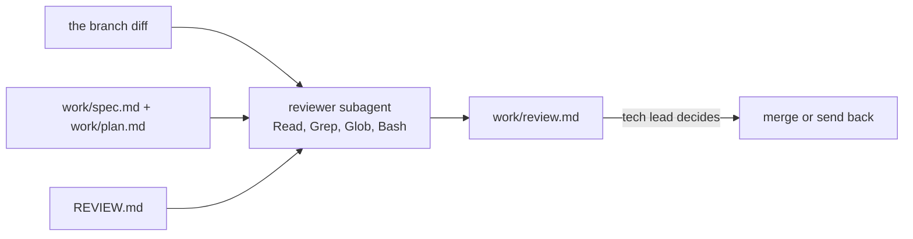

# Review with fresh eyes

## The problem

Sam's branch `teammate/local-deadlines` builds on the wrench ticket you built in Part 4. It shows crews each deadline in Brannock time. Every test passes. But it adds the 48 hours on the wall clock, not in real time.

For example, a bike is wrenched one night before the clocks go back. The branch gives it a deadline 49 real hours later. The bike is late, and the city charges 50 pounds.

The session that wrote a change is a poor judge of it. A **subagent** starts fresh, with only the diff, spec, plan and `REVIEW.md`. A good reviewer finds the bug here, and stays quiet on `teammate/deadline-labels`, which does the job safely.

A third branch, `teammate/queue-search`, builds SQL from a search word. Claude Code's built-in `/security-review` command should find that hole.



## Your challenge

Start the step and open Claude Code in `kestrel/`:

```bash
bun run start review-with-fresh-eyes
```

Expect: `kestrel/ is ready at the start of review-with-fresh-eyes.`

First, ask Claude Code for the reviewer:

The prompt is in [reviewer-prompt.md](../../reviewer-prompt.md).

Check the `tools:` line. Start a new session, so Claude Code loads the subagent, and ask:

```text
Use the reviewer subagent to review the branch origin/teammate/local-deadlines against main.
Then write its findings to work/review.md: a one-line heading, the findings table exactly as
REVIEW.md asks, and a last line 'Important findings left open: N'.
```

Last, in the course folder, record 3 reviews of each branch, each in a fresh copy:

```bash
bun parts/05-review-the-change/02-review-with-fresh-eyes/record.ts
```

Expect: `Saved 9 runs to kestrel/recordings/review-with-fresh-eyes/`

The last 3 runs call `/security-review` on the third branch.

## Done when

- `reviewer.md` has a name, a description and a tools list with no Edit or Write.
- `work/review.md` has an Important finding on the queue file, the clock change and a criterion id.
- 2 of 3 recorded reviews find the bug on the planted branch, and 2 of 3 find nothing Important on the clean one.
- 2 of 3 `/security-review` reports find the SQL injection on `teammate/queue-search`.
- Nits stay under the cap, and no run edited `src/`.

```bash
bun run verify review-with-fresh-eyes
```

Expect: `Done. All 10 rules pass.`


## If you get stuck

- `FAIL the reviewer's tools are read-only`: no `tools:` line means every tool. Ask for `tools: Read, Grep, Glob, Bash`.
- `FAIL ... the reviewer subagent ran`: Claude Code did the review itself. Name the subagent `reviewer`.
- `FAIL ... /security-review reports`: record again. The report must name the SQL injection in `src/crew-queue.ts`.
- `FAIL on the clean branch`: the reviewer calls everything Important. Point it at What Important means here.

## Words you will use

- **Subagent**: a helper Claude Code starts with a fresh context and its own tools. It reports back, then ends.
- **Clock change**: the night the clocks move one hour. The wall clock skips or repeats an hour; real time does not.
- **Control branch**: a branch with no bug, to test that the reviewer stays quiet.
