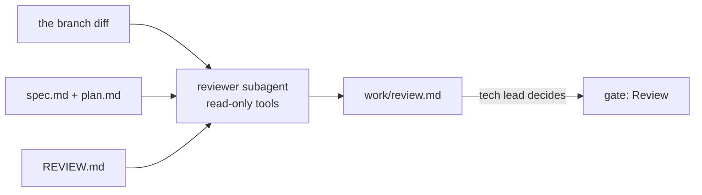

# Review the change

This part moves the **Objective**: review that finds what matters and stays short.

## The problem

A teammate's branch builds the queue from a time read on the local wall clock. On the night the clocks change, one hour of wrenches misses the 48 hour deadline. The branch passes every test.

Anthropic's own code review raised the share of pull requests with real review comments from 16% to 54%. Fewer than 1% of its findings were marked wrong ([Code Review for Claude Code](https://claude.com/resources/articles/code-review)). A review only helps when people read it, so it must stay short and find what matters.

For example, a good finding reads "Bugs, Important, src/crew-queue.ts: local time skips an hour on the clock change, breaks AC-8".



| Step                     | Minutes | What the check reads                                                                                                                                                                                                                                                                                                                                                                                                  |
| ------------------------ | ------- | --------------------------------------------------------------------------------------------------------------------------------------------------------------------------------------------------------------------------------------------------------------------------------------------------------------------------------------------------------------------------------------------------------------------- |
| `write-the-review-rules` | 10      | `REVIEW.md` with the passes Bugs, Security and Compliance, a definition of Important, a number cap on nits, and a do-not-report list that names `data/`. The tech-lead approval matches and comes after the qa approval                                                                                                                                                                                               |
| `review-with-fresh-eyes` | 20      | `.claude/agents/reviewer.md` has `name`, `description` and a `tools` list with no Edit or Write. In 2 of 3 recorded runs on the planted branch, the review has an Important finding that names the queue file, the clock change and a criterion id. In 2 of 3 runs on a clean branch, no Important finding. In 2 of 3 `/security-review` runs on a third branch, the report names the SQL injection in the queue file |

This part takes 30 minutes.

## Walkthrough

Start at the end of the build. Your `kestrel/` gets three teammate branches: one with the clock bug, one without, and one with a security hole.

```bash
bun run start write-the-review-rules
```

Expect: `kestrel/ is ready at the start of write-the-review-rules.`

In Claude Code, give it the prompt in the step's README. It writes `REVIEW.md`. Read it, then sign it in the course folder:

```bash
bun run approve REVIEW.md --role tech-lead
```

Expect: `Approved REVIEW.md as tech-lead`

```bash
bun run verify write-the-review-rules
```

Expect: `Done. All 8 rules pass.`

Next, start the second step:

```bash
bun run start review-with-fresh-eyes
```

Expect: `kestrel/ is ready at the start of review-with-fresh-eyes.`

In Claude Code, make the reviewer subagent and ask it to review `origin/teammate/local-deadlines`. Then record 3 reviews of each branch, and 3 runs of `/security-review` on a branch with a planted hole. This needs Claude Code signed in:

```bash
bun parts/05-review-the-change/02-review-with-fresh-eyes/record.ts
```

Expect: `Saved 9 runs to kestrel/recordings/review-with-fresh-eyes/`

With no Claude Code, copy the sample end state instead. It holds real recorded runs:

```bash
bun run catch-up review-with-fresh-eyes
```

Expect: `kestrel/ is now at the end of review-with-fresh-eyes, copied from the sample solution.`

```bash
bun run verify review-with-fresh-eyes
```

Expect: `Done. All 10 rules pass.`

```bash
bun run verify part review-the-change
```

Expect: `Part review-the-change is done: 2/2 steps pass.`

```text
Part review-the-change:
  PASS   write-the-review-rules  (8/8 rules)
  PASS   review-with-fresh-eyes  (10/10 rules)
Part review-the-change is done: 2/2 steps pass.
```

## Assignment

**The problem:** the clock-change bug passes every test. Find it with a reviewer that stays quiet when there is no bug.

**Hand in:** a pushed branch with `REVIEW.md`, `.claude/agents/reviewer.md`, `work/review.md` and `recordings/review-with-fresh-eyes/`. The grader runs `bun run verify part review-the-change` and reads one file.

| #   | Question                                                                                  | Answered by |
| --- | ----------------------------------------------------------------------------------------- | ----------- |
| 1   | Does `REVIEW.md` have the three passes, a meaning for Important and a number cap on nits? | verify      |
| 2   | Did the tech lead sign `REVIEW.md` after QA signed the acceptance tests?                  | verify      |
| 3   | Does the reviewer have a tools list with no Edit and no Write?                            | verify      |
| 4   | Is each finding in `work/review.md` tagged with a pass and a severity?                    | reader      |
| 5   | Did 2 of 3 runs find the planted bug, and 2 of 3 runs stay quiet on the clean branch?     | verify      |
| 6   | Did 2 of 3 `/security-review` runs find the planted SQL injection?                        | verify      |

Pass is 6 of 6.

## If you already know this

Rate the reviewer. Label each finding in the six saved reviews as right or wrong. Work out the share of real bugs it found and the share of clean branches it left alone. Change `REVIEW.md` once, record again, and see if the nit count drops.

## Finished

You now have rules a reviewer follows and a reviewer that cannot change code. Real runs prove it finds the bug and stays quiet on a clean branch. A built-in security review finds a planted SQL hole too. The tech lead sends Sam's branch back with one Important finding.

Next, in [Release the change](../06-release-the-change/README.md), Claude Code writes release notes for riders and crews from the same spec. Then you plan a rollout one district at a time, behind a gate only the release manager can open.
