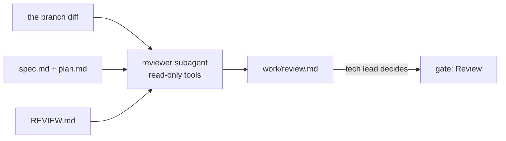

# Review the change

This part moves the **Objective**: review that finds what matters and stays short.

## The problem

A teammate's branch builds the queue from a time read in local time. On the night the clocks change, one hour of wrenches misses the 48 hour deadline. The branch passes every test.

Anthropic's own code review raised the share of pull requests with real review comments from 16% to 54%. Fewer than 1% of its findings were marked wrong ([Code Review for Claude Code](https://claude.com/resources/articles/code-review)).

For example, a good finding reads "Bugs, Important, src/crew-queue.ts: local time skips an hour on the clock change, breaks AC-4".

| Step                     | Minutes | What the check reads                                                                                                                                                                                                                                                                                       |
| ------------------------ | ------- | ---------------------------------------------------------------------------------------------------------------------------------------------------------------------------------------------------------------------------------------------------------------------------------------------------------- |
| `write-the-review-rules` | 10      | `REVIEW.md` with the passes Bugs, Security and Compliance, a definition of Important, a number cap on nits, and a do-not-report list that names `data/`. The tech-lead approval matches                                                                                                                    |
| `review-with-fresh-eyes` | 20      | `.claude/agents/reviewer.md` has `name`, `description` and a `tools` list with no Edit or Write. In 2 of 3 recorded runs on the planted branch, `work/review.md` has an Important finding that names the queue file, the clock change and an AC id. In 2 of 3 runs on a clean branch, no Important finding |

This part takes 30 minutes.

## Walkthrough

TODO(part session): one command per step, each followed by its `Expect:` line. Build each step's folder with `problem/`, `solution/` and `prompts.md`, and `wrong/`, as `parts/01-ready-the-repo/` does.
