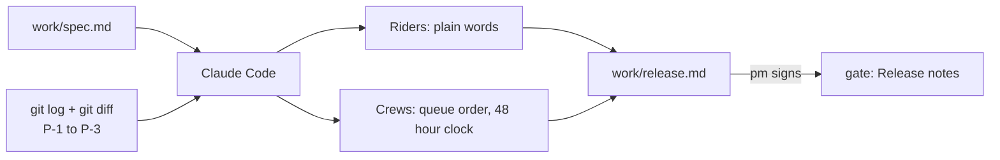

# Write the release notes

## The problem

The fix is built and reviewed. Now two groups need to hear about it, and they need different words.

Riders were never told why a bike vanished from the map. They thought the app was broken. Crews were never told that their queue order changed. Some kept working oldest job first.

For example, a vague prompt, "Write release notes for this change", gave real notes for engineers. Under "Riders", it said: "`POST /wrench` now sets `is_disabled: true` on the bike, so it shows as disabled in `vehicle_status.json`." No rider can read that.



## Your challenge

Start the step and open Claude Code in `kestrel/`:

```bash
bun run start write-the-release-notes
```

Expect: `kestrel/ is ready at the start of write-the-release-notes.`

Give Claude Code this job. It reads the spec and the merged commits, then writes for each audience:

```text
Write work/release.md, the release notes for this change. Read work/spec.md and the merged
change first: git log and git diff for the P-1 to P-3 commits. Use two sections. ## Riders is
for people who rent bikes. Write it in plain words a 12-year-old can read: short sentences, no
file names, no criterion ids, and no technical words such as feed, GBFS, API, deploy or SLA.
Say what changes for them, and thank them for reporting broken bikes. ## Crews is for the
repair crews. Say that the queue now puts the job that is due first on top, and that the 48
hour clock starts when the rider reports the bike, not when the job is opened. Keep the whole
file under 20 lines.
```

Read the Riders section out loud. Would a rider on a phone understand every word? Then sign it as the product manager, in the course folder:

```bash
bun run approve work/release.md --role pm
```

Expect: `Approved work/release.md as pm`

## Done when

- `work/release.md` has a Riders section and a Crews section.
- Riders reads at grade 6 or lower, with no criterion ids, file names or jargon.
- Crews says the job due first is on top, and the 48 hour clock starts at the rider's report.
- The product manager approved the notes as they are now, after `REVIEW.md` was approved.

```bash
bun run verify write-the-release-notes
```

Expect: `Done. All 7 rules pass.`

## If you get stuck

| What you see                               | Fix                                                                           |
| ------------------------------------------ | ----------------------------------------------------------------------------- |
| `FAIL the Riders section reads at grade 6` | Ask Claude Code for shorter sentences and shorter words in Riders.            |
| `FAIL ... no criterion ids, no file names` | Ask Claude Code to move every id, file name and field name out of Riders.     |
| `FAIL the product manager approved`        | The notes changed after you signed them. Read them again, then approve again. |

## Words you will use

- **Release notes**: a short page that tells people what changed and what it means for them.
- **Audience**: the people a section is for. Riders and crews need different words for the same change.
- **Reading grade**: about the school year a reader needs to follow a text. Grade 6 is about age 11 or 12.
- **Jargon**: a word only your team uses, such as "feed" or "GBFS". Riders say "the map".
