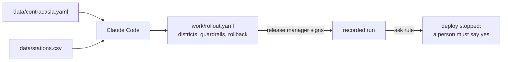
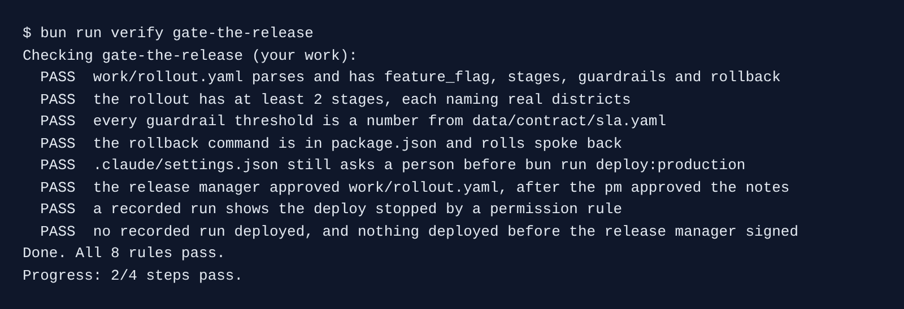

# Gate the release

## The problem

The last rollout went to all of Brannock at once. When it went wrong, every district felt it, and nobody had agreed when to stop.

A rollout plan answers three questions before anything ships. Who gets it first? Which number makes us stop? How do we go back? The stop numbers are not a matter of taste. The city contract already has them.

For example, SLA-9 says bike availability must stay at 96% or more. So the guardrail is "stop below 96", not "stop below 90 because that felt safe".

Last, Anthropic's [AI-native SDLC playbook](https://claude.com/resources/articles/the-ai-native-sdlc-playbook) says the agent "may act up to the production gate and cannot pass it". The ask rule from part 01 is that gate.



## Your challenge

Start the step and open Claude Code in `kestrel/`:

```bash
bun run start gate-the-release
```

Expect: `kestrel/ is ready at the start of gate-the-release.`

Give Claude Code this job:

```text
Write work/rollout.yaml, the rollout plan for this release. Read data/contract/sla.yaml and
data/stations.csv first. Use these keys: feature_flag, the name of the flag that turns the
change on. stages, a list with one district or a group of districts per stage, using the
district names in data/stations.csv and starting with North. guardrails, a list of metric with
stop_below or stop_above, where every threshold number comes from data/contract/sla.yaml, with
a comment that names the SLA id it comes from. rollback, with command (a bun run command that
exists in package.json) and when (what makes you run it). Do not invent a threshold.
```

Check each guardrail against `sla.yaml`. Then sign it as the release manager, in the course folder:

```bash
bun run approve work/rollout.yaml --role release-manager
```

Expect: `Approved work/rollout.yaml as release-manager`

Now test the gate. This asks Claude Code, headless, to ship. It even lists the deploy as an allowed tool:

```bash
bun parts/06-release-the-change/02-gate-the-release/record.ts
```

Expect: "Blocked by a permission rule: Bash bun run deploy:production"

## Done when

- `work/rollout.yaml` has a feature flag, at least 2 stages of real districts, guardrails and a rollback.
- Every guardrail number comes from `sla.yaml`, and the rollback command runs.
- The settings still ask before a deploy, and the release manager approved the plan.
- A recorded run shows the deploy stopped by a permission rule, and nothing deployed.

```bash
bun run verify gate-the-release
```

Expect: `Done. All 8 rules pass.`



## If you get stuck

- `FAIL every guardrail threshold is a number from data/contract/sla.yaml`: ask Claude Code where each number comes from. Replace any number it chose itself.
- `FAIL a recorded run shows the deploy stopped`: Claude Code may refuse on its own first. For example, it may notice that no code reads the feature flag yet. That is good judgement. Record again.
- "Only a person can approve": run approve in your own terminal, not inside Claude Code.

## Words you will use

- **Rollout**: how a change reaches people, step by step. Here, one district at a time.
- **Feature flag**: a switch that turns a change on or off without a new deploy.
- **Guardrail**: a number that stops the rollout when it is crossed.
- **Rollback**: going back to the last good release.
