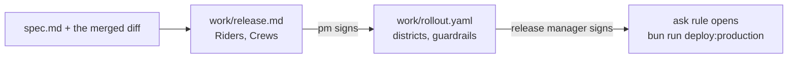

# Release the change

This part moves the **Objective**: a release a person authorises.

## The problem

Riders were never told why a bike vanished from the map. The last rollout went to all of Brannock at once.

Novo Nordisk's team cut clinical document work "10+ weeks to 10 minutes", with human reviewers approving every output ([Novo Nordisk](https://claude.com/customers/novo-nordisk)). The faster the agent, the more the gate matters.

For example, a guardrail "stop below 96" for bike availability comes straight from SLA-9 in the contract.

| Step                      | Minutes | What the check reads                                                                                                                                                                                                                                             |
| ------------------------- | ------- | ---------------------------------------------------------------------------------------------------------------------------------------------------------------------------------------------------------------------------------------------------------------- |
| `write-the-release-notes` | 10      | `work/release.md` with a Riders section at reading grade 6 or lower, with no AC ids or file names, and a Crews section that names the new queue order and the 48 hour clock. The pm approval matches                                                             |
| `gate-the-release`        | 20      | `work/rollout.yaml` parses, every guardrail number matches a value in `sla.yaml`, the rollback command is in `package.json`. A recorded run shows Claude Code stopped at the deploy by the ask rule. The release-manager approval of `work/rollout.yaml` matches |

This part takes 30 minutes.

## Walkthrough

TODO(part session): one command per step, each followed by its `Expect:` line. Build each step's folder with `problem/`, `solution/` and `prompts.md`, and `wrong/`, as `parts/01-ready-the-repo/` does.
