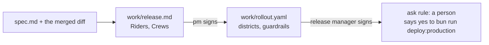

# Release the change

This part moves the **Objective**: a release a person authorises.

## The problem

Riders were never told why a bike vanished from the map. The last rollout went to all of Brannock at once.

Novo Nordisk's team cut clinical document work "from weeks to minutes", with human reviewers approving every output ([Novo Nordisk](https://claude.com/customers/novo-nordisk)). The faster the agent, the more the gate matters.

For example, a guardrail "stop below 96" for bike availability comes straight from SLA-9 in the contract.



| Step                      | Minutes | What the check reads                                                                                                                                                                                                                                              |
| ------------------------- | ------- | ----------------------------------------------------------------------------------------------------------------------------------------------------------------------------------------------------------------------------------------------------------------- |
| `write-the-release-notes` | 10      | `work/release.md` with a Riders section at reading grade 6 or lower, with no criterion ids, file names or jargon, and a Crews section that names the new queue order and the 48 hour clock. The pm approval matches and comes after `REVIEW.md`'s                 |
| `gate-the-release`        | 20      | `work/rollout.yaml` parses, has 2 or more stages of real districts, every guardrail number is in `sla.yaml`, and the rollback command runs. The settings still ask before a deploy. A recorded run shows the deploy stopped. The release-manager approval matches |

This part fits in one sitting.

## Walkthrough

Start at the end of the review. The build is approved and reviewed, and nothing has shipped.

```bash
bun run start write-the-release-notes
```

Expect: `kestrel/ is ready at the start of write-the-release-notes.`

In Claude Code, give it the prompt in the step's README. It writes `work/release.md` for riders and crews. Read it, then sign it in the course folder:

```bash
bun run approve work/release.md --role pm
```

Expect: `Approved work/release.md as pm`

```bash
bun run verify write-the-release-notes
```

Expect: `Done. All 7 rules pass.`

Next, start the second step:

```bash
bun run start gate-the-release
```

Expect: `kestrel/ is ready at the start of gate-the-release.`

Ask Claude Code for `work/rollout.yaml`, as the step's README shows. Sign it as the release manager:

```bash
bun run approve work/rollout.yaml --role release-manager
```

Expect: `Approved work/rollout.yaml as release-manager`

Then ask Claude Code, headless, to ship. This needs Claude Code signed in:

```bash
bun parts/06-release-the-change/02-gate-the-release/record.ts
```

Expect: "Blocked by a permission rule: Bash bun run deploy:production"

Claude Code may also stop on its own, because no code reads the feature flag yet. Then the run prints no Blocked line. Run it again. With no Claude Code, copy the sample end state instead. It holds real recorded runs:

```bash
bun run catch-up gate-the-release
```

Expect: `kestrel/ is now at the end of gate-the-release, copied from the sample solution.`

```bash
bun run verify gate-the-release
```

Expect: `Done. All 8 rules pass.`

```bash
bun run verify part release-the-change
```

Expect: `Part release-the-change is done: 2/2 steps pass.`

```text
Part release-the-change:
  PASS   write-the-release-notes  (7/7 rules)
  PASS   gate-the-release  (8/8 rules)
Part release-the-change is done: 2/2 steps pass.
```

Last, the release manager ships it. A person types this, not Claude Code:

```bash
cd kestrel && bun run deploy:production && cd ..
```

Expect: `Deployed spoke to production.`

## Assignment

**The problem:** riders were never told, and the last rollout hit the whole city at once.

**Hand in:** a pushed branch with `work/release.md`, `work/rollout.yaml`, both approvals and `recordings/gate-the-release/`. The grader runs `bun run verify part release-the-change` and reads one file.

| #   | Question                                                                            | Answered by       |
| --- | ----------------------------------------------------------------------------------- | ----------------- |
| 1   | Does the Riders section read at grade 6 or lower, with no file names or ids?        | verify            |
| 2   | Does the Crews section name the new queue order and the 48 hour clock?              | verify            |
| 3   | Does every guardrail threshold come from the contract, with its SLA id named?       | verify and reader |
| 4   | Does the rollout name a rollback command that runs?                                 | verify            |
| 5   | Does a recorded run show the deploy stopped by the ask rule, with nothing deployed? | verify            |
| 6   | Did the pm sign the notes, and then the release manager sign the rollout?           | verify            |

Pass is 6 of 6.

## If you already know this

Add a guardrail for e-bike battery faults. Take its threshold from the repair data in `data/`, not from taste. Then write one line in the rollout that says which SLA it protects.

## Finished

You now have release notes for two audiences and a rollout that goes one district at a time. Its guardrails come from the contract, and its rollback runs. A recorded run proves that Claude Code cannot ship without a person. The release manager types the deploy.

Next, in [Learn from the incident](../07-learn-from-the-incident/README.md), the first district goes live and something goes wrong. A retried wrench report disables 212 bikes in North. Claude Code helps you write a blameless postmortem and turn it into a test.

## Watch and read

| Kind  | Title                                 | Author                                 | Why                                                                       | Link                                                                       |
| ----- | ------------------------------------- | -------------------------------------- | ------------------------------------------------------------------------- | -------------------------------------------------------------------------- |
| video | Claude Code best practices            | Anthropic, talk at its developer event | The team shows CLAUDE.md, permissions, tools and planning in one sitting. | <https://www.youtube.com/watch?v=gv0WHhKelSE>                              |
| video | Claude Code best practices webinar    | Anthropic                              | Practical habits from the team that runs the tool every day.              | <https://www.anthropic.com/webinars/claude-code-best-practices-lightspeed> |
| read  | Permissions                           | Anthropic docs                         | How a rule stops a deploy until a person agrees.                          | <https://code.claude.com/docs/en/permissions>                              |
| read  | Connect Claude Code to tools with MCP | Anthropic docs                         | How outside tools join a session.                                         | <https://code.claude.com/docs/en/mcp>                                      |
| read  | Hooks                                 | Anthropic docs                         | A hook can gate a risky command.                                          | <https://code.claude.com/docs/en/hooks>                                    |
