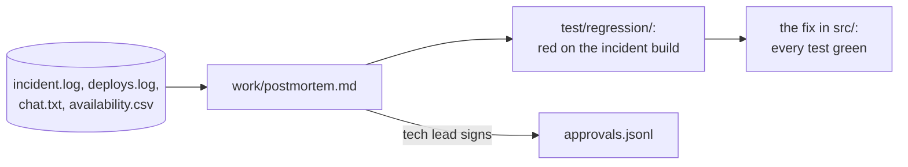
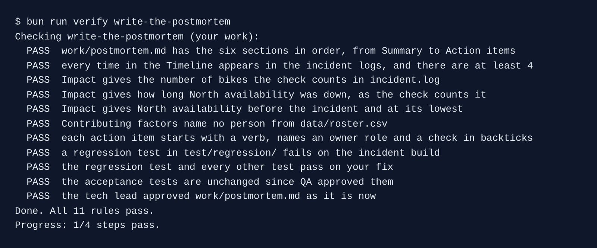

# Write the postmortem

## The problem

The North rollout went live. Then the rider app retried failed wrench reports, and the same wrench arrived three times. Bikes left the map, and North fell under the contract line.

A **postmortem** is a short report after an incident: what happened, what it cost, why, and what changes now. Without one, the same bug comes back.

For example, `data/incidents/north-double-wrench/incident.log` has the line "2026-11-03T07:40:00Z retry storm begins".



## Your challenge

Start the step:

```bash
bun run start write-the-postmortem
```

Expect: `kestrel/ is ready at the start of write-the-postmortem.`

Open Claude Code in `kestrel/`. Give it two jobs, one at a time.

1. Ask for the postmortem:

```text
Read every file in data/incidents/north-double-wrench/. Write work/postmortem.md, a blameless
postmortem, with the sections Summary, Impact, Timeline, Contributing factors, What went well,
Action items, in that order. Work out each Impact number from the logs: bikes, how long it
lasted, North availability before and at its lowest. Timeline uses only HH:MM times from the
logs. Contributing factors name systems, never a person. Number the action items A-1, A-2 and
so on; each starts with a verb and has an Owner role and a Check in backticks. A-1 is a
regression test that sends the same wrench three times. Do not write the test or fix yet.
```

If a Check names no command or file, send Claude back.

2. Ask for the test first, then the fix:

```text
Do action item A-1. Write the test in test/regression/: the same wrench three times with one
request_id gives one repair job. Run bun test test/regression and show me it fails. Commit the
test alone, message starting "A-1:". Then fix src/ so a retry is the same report. Run bun test
until all pass, without touching test/acceptance/. Commit the fix alone, message starting "A-1:".
```

A test that never failed proves nothing. Watch for the red run before the fix.

Last, in the course folder, sign the postmortem as the tech lead:

```bash
bun run approve work/postmortem.md --role tech-lead
```

Expect: `Approved work/postmortem.md as tech-lead`

## Done when

- `work/postmortem.md` has the six sections in order.
- Every Timeline time is in the logs. Impact gives 212 bikes, just over 3 hours, 97.8% and 89.0%.
- Contributing factors name no person. Each action item has a verb, an Owner role and a Check.
- A test in `test/regression/` fails on the incident build and passes on your fix.
- The acceptance tests are unchanged, and the tech lead approved the postmortem.

```bash
bun run verify write-the-postmortem
```

Expect: `Done. All 11 rules pass.`



## If you get stuck

- `FAIL Contributing factors name no person`: ask Claude Code to name the missing check, not who was on call.
- `FAIL a regression test ... fails on the incident build`: the test passes on the old code too. Ask for one `request_id` sent three times.
- `FAIL the tech lead approved ...`: the file changed after you signed it. Approve it again.

## Words you will use

- **Blameless**: the report names the system that let a mistake through, never a person.
- **Action item**: one change, with an owner and a check that proves it is done.
- **Regression test**: a test that replays what broke, so the bug cannot come back unseen.
- **Incident build**: the code that was live during the incident.
