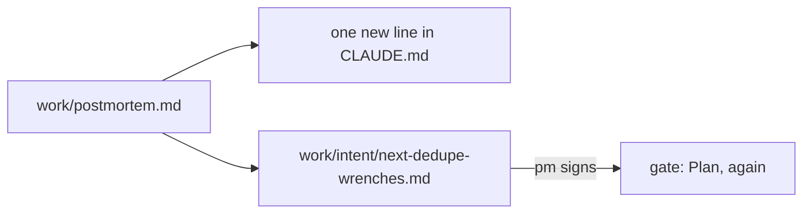
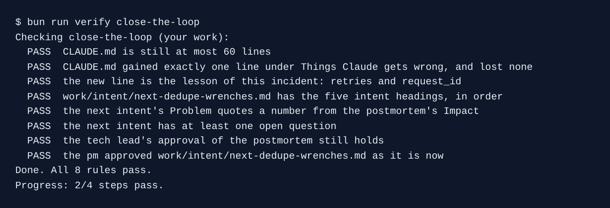

# Close the loop

## The problem

The postmortem is signed and the retry bug is fixed. But Claude Code has no memory of the incident. Next month, someone asks it for a new write route, and it may write the same bug again.

The postmortem also found a second risk. Two different riders can wrench the same bike, and each report opens its own job. Nobody has asked for that fix yet.

For example, your `CLAUDE.md` has one line under `## Things Claude gets wrong` today: `The 48 hour clock starts at the wrench`. It says nothing about retries.



## Your challenge

Did you just finish `write-the-postmortem`? Then keep your `kestrel/` as it is. To jump in here instead, start the step:

```bash
bun run start close-the-loop
```

Expect: `kestrel/ is ready at the start of close-the-loop.`

Open Claude Code in `kestrel/`. Give it two jobs, one at a time.

1. Teach Claude Code the lesson, in one line:

```text
Read work/postmortem.md. Add exactly one line under ## Things Claude gets wrong in CLAUDE.md:
the lesson from this incident that would stop Claude writing the same bug again. Change nothing
else in CLAUDE.md. It must stay at 60 lines or fewer. Commit only CLAUDE.md, with a message
that starts with "Close the loop:".
```

Claude Code asks before it runs `git add` and `git commit`. Read the diff first. Say yes only if one line changed.

2. Start the next change from the problem:

```text
Write work/intent/next-dedupe-wrenches.md for the next change: two different riders wrench the
same bike, and each report opens its own repair job. Use the same five headings as
work/intent.md, in the same order: Problem, Proposed outcome, Affected users and systems,
Constraints, Open questions. In Problem, quote at least one number from the Impact section of
work/postmortem.md. Under Constraints, say that the 48 hour clock in data/contract/sla.yaml does
not change. Do not change any code, and do not commit.
```

Last, in the course folder, sign the intent as the product manager:

```bash
bun run approve work/intent/next-dedupe-wrenches.md --role pm
```

Expect: `Approved work/intent/next-dedupe-wrenches.md as pm`

## Done when

- `CLAUDE.md` gained exactly one line under `## Things Claude gets wrong`, lost none, and is at most 60 lines.
- The new line is about retries and `request_id`.
- `work/intent/next-dedupe-wrenches.md` has the five intent headings, in order, and an open question.
- Its Problem quotes a number from the postmortem's Impact, for example 212 bikes.
- The postmortem is still approved, and the pm approved the new intent.

```bash
bun run verify close-the-loop
```

Expect: `Done. All 8 rules pass.`



## If you get stuck

| What you see                                     | Fix                                                                                 |
| ------------------------------------------------ | ----------------------------------------------------------------------------------- |
| `FAIL CLAUDE.md gained exactly one line`         | In `kestrel/`, run `git checkout CLAUDE.md`. Ask again, and say "exactly one line". |
| `FAIL the next intent's Problem quotes a number` | Ask Claude Code to copy one number from the Impact section, word for word.          |
| `FAIL the pm approved ...`                       | The intent changed after you signed it. Read it and run `bun run approve` again.    |

## Words you will use

- **Close the loop**: the end of one change starts the next one, from what you learned.
- **Intent**: a one-page note of the problem, written before any spec or code.
- **Lesson line**: one short rule in `CLAUDE.md` that Claude Code reads at the start of every session.
