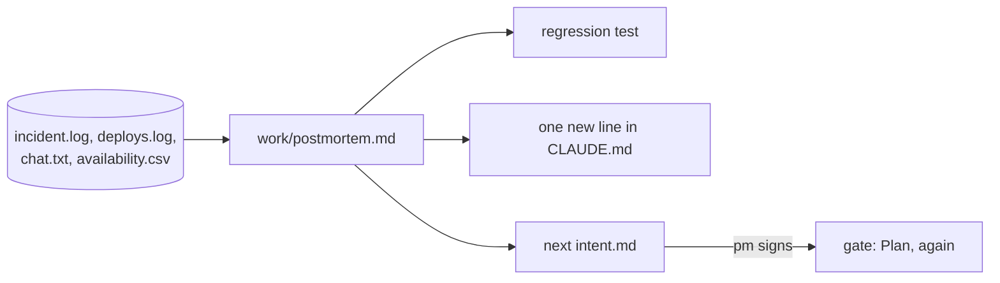

# Learn from the incident

This part moves the **Transformation** and the **Goal**: the loop closes on its own evidence.

## The problem

Two days after North went live, the rider app retried failed wrench reports. The same wrench arrived three times. 212 bikes showed as disabled for 3 hours 10 minutes, and North bike availability fell under the contract line.

PagerDuty's open postmortem guide says "An individual's action should never be considered a root cause" ([PagerDuty postmortem guide](https://github.com/PagerDuty/postmortem-docs/blob/master/docs/how_to_write/writing.md)). Money Forward built an incident tool with Claude and cut API work "from 2 days to 5 hours" ([Money Forward](https://claude.com/customers/money-forward)).

For example, "Sam ran the deploy" is blame. "POST /wrench had no duplicate check" is a contributing factor.

| Step                   | Minutes | What the check reads                                                                                                                                                                                                                                                                                                                                    |
| ---------------------- | ------- | ------------------------------------------------------------------------------------------------------------------------------------------------------------------------------------------------------------------------------------------------------------------------------------------------------------------------------------------------------- |
| `write-the-postmortem` | 25      | `work/postmortem.md` with Summary, Impact, Timeline, Contributing factors, What went well, Action items. Every timeline time is in the logs. Impact numbers match the check's own count. No name from `roster.csv` in Contributing factors. Each action item starts with a verb and names an owner role and a check. `wrong/blames-the-engineer/` fails |
| `close-the-loop`       | 15      | `CLAUDE.md` gained exactly one line under Things Claude gets wrong and is still at most 60 lines. `work/intent/next-dedupe-wrenches.md` has the five intent headings and quotes a number from the postmortem. The pm approval matches                                                                                                                   |

This part takes 40 minutes.

## Walkthrough

TODO(part session): one command per step, each followed by its `Expect:` line. Build each step's folder with `problem/`, `solution/` and `prompts.md`, and `wrong/`, as `parts/01-ready-the-repo/` does.
