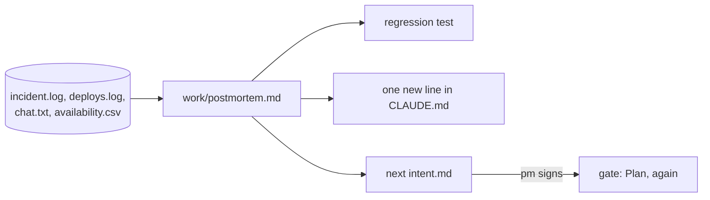

# Learn from the incident

This part moves the **Transformation** and the **Goal**: the loop closes on its own evidence.

## The problem

Two days after North went live, the rider app retried failed wrench reports. The same wrench arrived three times. 212 bikes showed as disabled for just over 3 hours, and North bike availability fell under the contract line.

PagerDuty's open postmortem guide says "An individual's action should never be considered a root cause" ([PagerDuty postmortem guide](https://github.com/PagerDuty/postmortem-docs/blob/master/docs/how_to_write/writing.md)). Money Forward built an incident tool with Claude and cut API work "from 2 days to 5 hours" ([Money Forward](https://claude.com/customers/money-forward)).

For example, "Sam ran the deploy" is blame. "POST /wrench had no duplicate check" is a contributing factor.



| Step                   | Minutes | What the check reads                                                                                                                                                                                                                                                                                                                                    |
| ---------------------- | ------- | ------------------------------------------------------------------------------------------------------------------------------------------------------------------------------------------------------------------------------------------------------------------------------------------------------------------------------------------------------- |
| `write-the-postmortem` | 25      | `work/postmortem.md` with Summary, Impact, Timeline, Contributing factors, What went well, Action items. Every timeline time is in the logs. Impact numbers match the check's own count. No name from `roster.csv` in Contributing factors. Each action item starts with a verb and names an owner role and a check. `wrong/blames-the-engineer/` fails |
| `close-the-loop`       | 15      | `CLAUDE.md` gained exactly one line under Things Claude gets wrong and is still at most 60 lines. `work/intent/next-dedupe-wrenches.md` has the five intent headings and quotes a number from the postmortem. The pm approval matches                                                                                                                   |

This part fits in one sitting.

## Walkthrough

Each step starts where the step before it ended. To jump in here, make `kestrel/` the begin state of the first step:

```bash
bun run start write-the-postmortem
```

Expect: `kestrel/ is ready at the start of write-the-postmortem.`

Your `kestrel/` now holds the incident logs in `data/incidents/north-double-wrench/`. Follow the step's README in Claude Code. Then sign the postmortem:

```bash
bun run approve work/postmortem.md --role tech-lead
```

Expect: `Approved work/postmortem.md as tech-lead`

```bash
bun run verify write-the-postmortem
```

Expect: `Done. All 11 rules pass.`

Go on to `close-the-loop` in the same `kestrel/`. Follow its README, then sign the next intent:

```bash
bun run approve work/intent/next-dedupe-wrenches.md --role pm
```

Expect: `Approved work/intent/next-dedupe-wrenches.md as pm`

```bash
bun run verify close-the-loop
```

Expect: `Done. All 8 rules pass.`

Check the whole part:

```bash
bun run verify part learn-from-the-incident
```

Expect: `Part learn-from-the-incident is done: 2/2 steps pass.`

For example, a passing part prints these lines:

```text
Part learn-from-the-incident:
  PASS   write-the-postmortem  (11/11 rules)
  PASS   close-the-loop  (8/8 rules)
Part learn-from-the-incident is done: 2/2 steps pass.
```

To see the sample end state without a live Claude Code, run `bun run catch-up close-the-loop`. It copies the recorded end state into `kestrel/` and keeps your old copy in `.kestrel-backups/`.

## Assignment

Hand in a pushed branch with `work/postmortem.md`, the regression test in `test/regression/`, the fix, the new line in `CLAUDE.md` and `work/intent/next-dedupe-wrenches.md`, with both approvals.

| #   | Question                                                                                | Answered by                           |
| --- | --------------------------------------------------------------------------------------- | ------------------------------------- |
| 1   | Does every Impact number match the logs: 212 bikes, just over 3 hours, 97.8% and 89.0%? | `bun run verify write-the-postmortem` |
| 2   | Do the Contributing factors name no person?                                             | `bun run verify write-the-postmortem` |
| 3   | Does every action item have a verb, an owner role and a check?                          | `bun run verify write-the-postmortem` |
| 4   | Is the regression test red on the incident build and green on the fix?                  | `bun run verify write-the-postmortem` |
| 5   | Was the test committed before the fix?                                                  | a reader, with `git log --oneline`    |
| 6   | Did `CLAUDE.md` gain exactly one line, and did the pm sign the next intent?             | `bun run verify close-the-loop`       |

Pass is 6 of 6.

**If you already know this:** turn the incident into a recorded Claude Code run. Ask Claude Code, headless, for a new write route. Then show that in 2 of 3 runs its test sends the same request twice. Your new `CLAUDE.md` line is the reason.

## Finished

You now have a blameless postmortem with numbers a script can check. You have a regression test that failed before the fix. Claude Code reads one new lesson in every session. And the next change has a signed intent. The loop is closed: production taught the plan.

Next, in Part 8, `run-the-team`, you measure the whole lifecycle from git and the deploy log. Then you write the team's playbook, and the last check walks the chain you built.

## Watch and read

| Kind  | Title                                 | Author                | Why                                                           | Link                                                                     |
| ----- | ------------------------------------- | --------------------- | ------------------------------------------------------------- | ------------------------------------------------------------------------ |
| video | Claude Code advanced patterns webinar | Anthropic             | Subagents and hooks for work that runs in many steps.         | <https://www.anthropic.com/webinars/claude-code-advanced-patterns>       |
| video | Claude Code advanced workshop         | Anthropic             | A hands-on session on running several agents at once.         | <https://www.anthropic.com/webinars/claude-code-workshop-advanced>       |
| read  | Postmortem culture                    | Google SRE Workbook   | The method for blameless reviews, from the team that runs it. | <https://sre.google/workbook/postmortem-culture/>                        |
| read  | Demystifying evals for AI agents      | Anthropic Engineering | How to turn a failure into a test that stays.                 | <https://www.anthropic.com/engineering/demystifying-evals-for-ai-agents> |
| read  | Best practices for agentic coding     | Anthropic Engineering | Why each fix needs a check.                                   | <https://www.anthropic.com/engineering/claude-code-best-practices>       |
