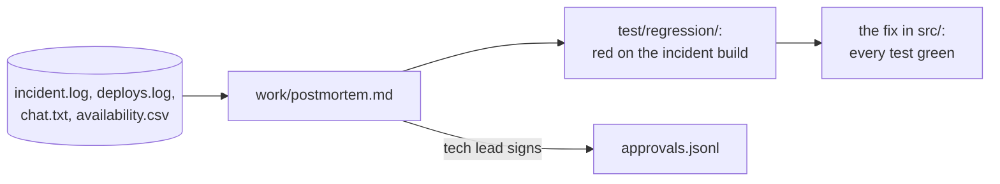

# Write the postmortem

## The problem

The North rollout went live. Then the rider app retried failed wrench reports, and the same wrench arrived three times. Bikes left the map, and North availability fell under the contract line.

The team wants to move on. But without a written postmortem, the same bug comes back. A **postmortem** is a short report after an incident: what happened, what it cost, why, and what changes now.

The raw facts are in `data/incidents/north-double-wrench/`. For example, `incident.log` has the line `2026-11-03T07:40:00Z retry storm begins`, and `availability.csv` shows North at `97.8` before it and `89.0` at the lowest point.



## Your challenge

Open Claude Code in `kestrel/`. Give it two jobs, one at a time.

1. Ask for the postmortem:

```text
Read every file in data/incidents/north-double-wrench/. Write work/postmortem.md, a blameless
postmortem, with these sections in this order: Summary, Impact, Timeline, Contributing factors,
What went well, Action items. In Impact, give the number of bikes, how long it lasted, and North
availability before the incident and at its lowest. Work each number out from the logs and
availability.csv. In Timeline, use only times that appear in the logs, written as HH:MM.
Contributing factors name systems and missing checks, never a person. Number the action items
A-1, A-2 and so on. Each starts with a verb and names an Owner (a role, not a name) and a Check:
a command or file that proves it is done. A-1 is a regression test in test/regression/ that
sends the same wrench three times. Do not write the test or the fix yet.
```

Read what Claude wrote. Look at every action item. If a Check names no command or file, send Claude back to fix it.

2. Ask for the test first, then the fix:

```text
Do action item A-1 from work/postmortem.md. Write the regression test in test/regression/: it
sends the same wrench three times with the same request_id and expects one repair job for that
bike. Run it with bun test test/regression and show me that it fails on this build. Commit the
test on its own with a message that starts with "A-1:". Then fix src/ so a retry with the same
request_id is the same report. Run bun test: every test must pass, and do not touch
test/acceptance/. Commit the fix on its own with a message that starts with "A-1:".
```

Watch for the red test before the fix. A test that never failed proves nothing.

Last, in the course folder, sign the postmortem as the tech lead:

```bash
bun run approve work/postmortem.md --role tech-lead
```

Expect: `Approved work/postmortem.md as tech-lead`

## Done when

- `work/postmortem.md` has the six sections in order.
- Every Timeline time is in the logs. Impact gives 212 bikes, 3 hours 10 minutes, 97.8% and 89.0%.
- Contributing factors name no person from `data/roster.csv`.
- Each action item starts with a verb and has an Owner role and a Check in backticks.
- A test in `test/regression/` fails on the incident build and passes on your fix.
- The acceptance tests are unchanged, and the tech lead approved the postmortem.

```bash
bun run verify write-the-postmortem
```

Expect: `Done. All 11 rules pass.`


## If you get stuck

| What you see                                              | Fix                                                                         |
| --------------------------------------------------------- | --------------------------------------------------------------------------- |
| `FAIL Contributing factors name no person`                | Ask Claude Code to name the missing check, not who was on call.             |
| `FAIL each action item starts with a verb`                | Ask for an Owner role and a Check in backticks on every item.               |
| `FAIL a regression test in test/regression/ fails on ...` | The test passes on the old code too. Ask Claude to send one `request_id` three times. |
| `FAIL the tech lead approved work/postmortem.md`          | You changed the file after you signed it. Run `bun run approve` again.      |

## Words you will use

- **Blameless**: the report names the system that let a mistake through, never the person who made it.
- **Contributing factor**: one reason the incident happened or got worse.
- **Action item**: one change, with an owner and a check that proves it is done.
- **Regression test**: a test that sends what broke production, so the bug cannot come back unseen.
- **Incident build**: the code that was live when the incident happened.
