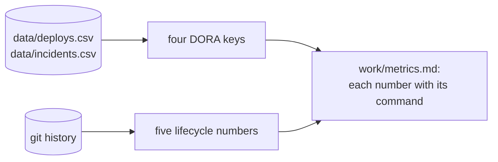
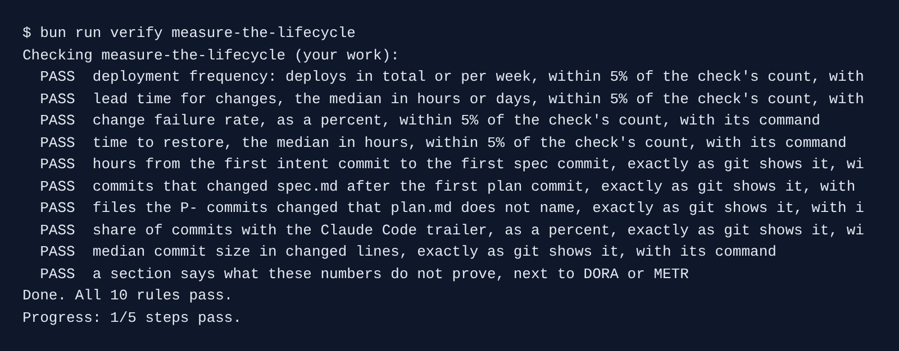

# Measure the lifecycle

## The problem

The director asks: "Did the Claude Code seats pay off?" A feeling is not an answer. Vendor numbers are not your numbers. Only your own deploy log and git history can answer for your team.

For example, `data/deploys.csv` has 69 deploys, and 9 of them have an `incident_id`. That is a change failure rate of 13%. Git can tell you more: how many commits carry Claude Code's `Co-Authored-By: Claude` trailer, and how big each commit was.



## Your challenge

Open Claude Code in `kestrel/` and ask for the numbers, each with the command that printed it:

```text
Write work/metrics.md with the team's lifecycle numbers. Next to every number, put the exact
command that printed it, in backticks.
## DORA keys, from data/deploys.csv and data/incidents.csv: a table with Deployment frequency
(deploys in total, and per week from the first to the last deployed_at), Lead time for changes
(median hours from committed_at to deployed_at), Change failure rate (percent of deploys with
an incident_id) and Time to restore (median hours from started_at to resolved_at).
## This feature, from git: count only the commits from the first one up to and including
"approve: work/intent/next-dedupe-wrenches.md by pm". A table with Intent to spec (hours from
the first commit that changed work/intent.md to the first commit that changed work/spec.md, by
author date), Spec commits after the first plan commit, Files outside plan.md (files changed by
commits whose subject starts with P- that work/plan.md does not name), Share of commits with the
Co-Authored-By: Claude trailer (percent), and Median commit size (median of added plus deleted
lines per commit, skipping the very first commit).
## What these numbers do not prove: compare one number with DORA or METR, and say what one
feature cannot show.
Do not commit.
```

Claude Code asks before it runs `git log` or `bun -e`. Say yes: these commands only read.

Pick one number and run its command yourself. If it prints a different number, send Claude back.

## Done when

- The four DORA keys are within 5% of the check's own count, each with its command.
- The five git numbers match the check exactly, each with its command.
- A `## What these numbers do not prove` section compares one number with DORA or METR.

```bash
bun run verify measure-the-lifecycle
```

Expect: `Done. All 10 rules pass.`



## If you get stuck

- `FAIL ... with its command`: the number is there but has no command in backticks on the same line.
- `FAIL share of commits with the Claude Code trailer`: count only up to the pm's approval of the next intent. Later commits change the share.
- `FAIL median commit size`: skip the very first commit. It holds the whole repo.

## Words you will use

- **DORA keys**: four delivery numbers from the DORA research: deploy frequency, lead time, change failure rate and time to restore.
- **Lead time**: hours from a commit to its deploy.
- **Trailer**: a `Key: value` line at the end of a commit message. Claude Code adds `Co-Authored-By: Claude`.
- **Median**: the middle value when you sort them all.
