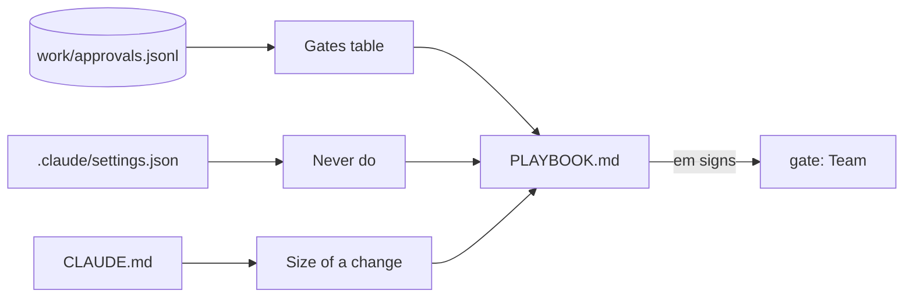
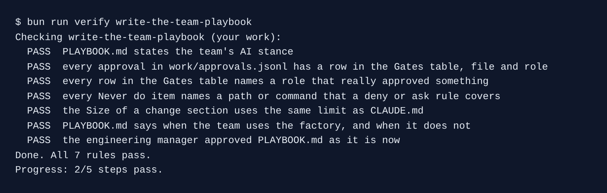

# Write the team playbook

## The problem

A new engineer joins the spoke team next month. They ask: "Which files need a signature? What may Claude Code never do? How big may a commit be?" Today the answers live in five places: `work/approvals.jsonl`, `.claude/settings.json`, `CLAUDE.md`, and people's heads.

A **playbook** puts them in one page. But a playbook can lie. It can list a gate nobody signs, or a rule nothing enforces.

For example, a playbook that says "QA signs every release" is wrong here. In `work/approvals.jsonl`, QA signed `test/acceptance` and nothing else.



## Your challenge

Open Claude Code in `kestrel/`. Ask it to write only what the repo already enforces:

```text
Write PLAYBOOK.md at the repo root: how this team works with Claude Code. Use these sections.
## Our AI stance: two or three sentences on who writes and who signs.
## Gates: a table with File, Who approves, How it is recorded. One row for every file in
work/approvals.jsonl, with the role that approved it.
## Never do: one bullet per deny or ask rule in .claude/settings.json, naming its path or
command in backticks.
## Size of a change: the changed-lines limit from CLAUDE.md.
## When we use the factory: which changes may run with no person in the loop, and which never may.
Only write what the repo already enforces. Do not commit.
```

Read the Gates table next to `work/approvals.jsonl`. Every row must be a real signature. Then, in the course folder, sign it as the engineering manager:

```bash
bun run approve PLAYBOOK.md --role em
```

Expect: `Approved PLAYBOOK.md as em`

## Done when

- `PLAYBOOK.md` has a stance, a Gates table, a Never do list, a size limit and a factory section.
- Every approval has a Gates row with its file and role, and every row is a real role.
- Every Never do item names a path or command that a deny or ask rule covers.
- The size limit is the one in `CLAUDE.md`: 200 changed lines.
- The engineering manager approved `PLAYBOOK.md` as it is now.

```bash
bun run verify write-the-team-playbook
```

Expect: `Done. All 7 rules pass.`



## If you get stuck

- `FAIL every approval ... has a row in the Gates table`: a signed file is missing. Ask Claude Code to read `work/approvals.jsonl` again.
- `FAIL every Never do item names a path or command`: an item names a wish, not a rule. Remove it, or add the rule to settings first.
- `FAIL the engineering manager approved ...`: the file changed after you signed it. Approve it again.

## Words you will use

- **Playbook**: one page that says how the team works, and that the repo can prove.
- **Gate**: a file a named role must sign before the next stage starts.
- **The factory**: changes that run from issue to pull request with no person in the loop. Another course teaches it.
