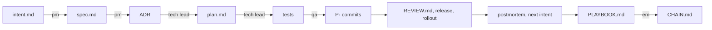
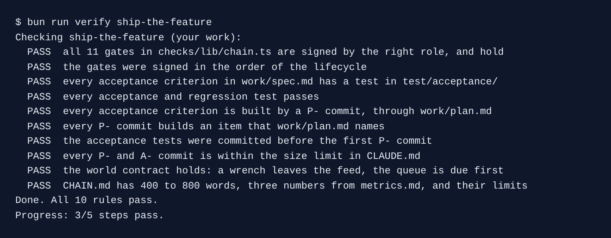

# Ship the feature

## The problem

You carried one feature from a raw problem to production and back through an incident. Every stage left a file, and every gate left a signature. Now prove the chain holds end to end, and write it up for someone who reads one file.

For example, `AC-1` in `work/spec.md` must lead to `test/acceptance/ac-1-wrench-disables-bike.test.ts`, to the commit "P-1: disable the bike when a wrench arrives", to the `P-1` line in `work/plan.md`.



## Your challenge

Did you just finish `write-the-team-playbook`? Then keep your `kestrel/` as it is. To jump in here instead, start the step:

```bash
bun run start ship-the-feature
```

Expect: `kestrel/ is ready at the start of ship-the-feature.`

Open Claude Code in `kestrel/` and ask for the write-up:

```text
Write CHAIN.md at the repo root, 400 to 800 words, for a reader who opens only this file. Walk
the chain from work/intent.md to PLAYBOOK.md: each stage, its file, and who signed it, from
work/approvals.jsonl. Quote three numbers from work/metrics.md exactly as they are written
there. Say in one sentence what these numbers do not prove. Do not change any other file, and
do not commit.
```

Read `git status` after the run. Only `CHAIN.md` should be new. If Claude changed a signed file, its gate is open again.

## Done when

- All 11 gates in `checks/lib/chain.ts` are signed by the right role, in order, and still hold.
- Every AC id has a test, and every acceptance and regression test passes.
- Every AC id is built by a `P-` commit through `work/plan.md`, after the tests, under 200 lines.
- A wrenched bike leaves the feed, and the North queue is due first.
- `CHAIN.md` has 400 to 800 words, three numbers from `work/metrics.md`, and what they do not prove.

```bash
bun run verify ship-the-feature
```

Expect: `Done. All 10 rules pass.`



## If you get stuck

- `FAIL all 11 gates ... still hold`: a signed file changed. Run `git log -p` on it, undo the change, or sign it again.
- `FAIL the world contract holds`: in the course folder, run `bun run world`. In a second terminal, run `bun run world wrench B-2207` and read what it prints.
- `FAIL CHAIN.md ...`: ask Claude Code to copy three numbers from `work/metrics.md` word for word.

## Words you will use

- **The chain**: every stage file, linked by signatures, from the problem to the shipped line.
- **Trace**: following one acceptance criterion through its test, its commit and its plan item.
- **World contract**: what spoke must answer over HTTP, whatever code is behind it.
