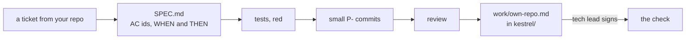

# Ship a feature in your own repo

## The problem

Everything so far ran on Kestrel, a repo made for the course. A habit only counts when it works on your own code. Most people drop it at this point and go back to "just build it".

For example, a small command line tool showed expired food as `-2 days`. The ticket said 3 of the 8 items in the list were already expired.



## Your challenge

Pick a small real change in a repo you own. It should take an afternoon at most, and it needs a way to run tests. Do not pick a rewrite.

Start the step, so `kestrel/` holds the whole chain so far:

```bash
bun run start ship-in-your-own-repo
```

Expect: `kestrel/ is ready at the start of ship-in-your-own-repo.`

Now work in your own repo, one move at a time, with Claude Code. Each move is one you already know.

1. Write the ticket and ask for the spec. Name the problem, give one real number, and ask for three criteria named AC-1, AC-2 and AC-3, each with a WHEN and a THEN. Do not let it write code yet.
2. Ask for one failing test for each criterion, named for its id. Run the tests and read the failure. Commit the spec and the tests, with a message that starts with `P-1:`.
3. Ask for the change in small commits, one for each plan item, with messages that start with `P-2:` and `P-3:`. Run the tests after each one.
4. Ask for a review in plan mode, as a reviewer who did not write the change. Read every finding yourself.

Last, ask Claude Code to write the evidence into `kestrel/work/own-repo.md`. Run it from your own repo, and give it the path:

```text
Write own-repo.md for the feature this repo just got. Read SPEC.md and git log first, and run
the tests. Use these headings in this order: ## Repo, ## Ticket, ## Spec, ## Proof, ##
Commits, ## Review. Repo is one line: what the project does. Ticket is the problem in three
lines at most, with one real number from the ticket. Spec lists each acceptance criterion as
its id, then WHEN and THEN on one line. Proof has two bullets: Red, the command and the line
it printed when the tests ran on the first commit, before any code change, with how many
tests failed, and Green, the command and the line it printed now, with 0 failed. Commits has
one line for each commit that starts with P-: its hash, its subject and its changed lines
(from git show --shortstat). Review is two sentences: what the reviewer found, and what you
will do about it. Use only numbers and output you ran or read. Do not change any other file,
and do not commit.
```

Open the file and spot check one number. Run the command it names, and see if you get the same line. Then copy it to `kestrel/work/own-repo.md` and sign it as the tech lead, in the course folder:

```bash
bun run approve work/own-repo.md --role tech-lead
```

Expect: `Approved work/own-repo.md as tech-lead`

## Done when

- `work/own-repo.md` has the six headings, in order, and the Ticket has a real number.
- The Spec has at least 3 criteria, each with WHEN and THEN.
- The Proof shows the tests red before the change, with a fail count, and green now, with 0 fail.
- At least 2 commits start with `P-`, and none is over 200 changed lines.
- The Review says what was found and what you will do about it, and the tech lead signed the file.

```bash
bun run verify ship-in-your-own-repo
```

Expect: `Done. All 9 rules pass.`

The check reads only this one file. It cannot see your other repo, so a person must read the evidence. If a number looks too neat, run its command.

## If you get stuck

- `FAIL the Proof shows the tests red`: run the tests on the first commit, before any code change. Use `git stash` or a fresh clone at that commit.
- `FAIL no commit is over 200 changed lines`: ask Claude Code to split the change, one commit for each plan item.
- `FAIL the Spec has at least 3 criteria`: write each one on a single line, as `AC-1: WHEN ... THEN ...`.
- `FAIL the tech lead approved ...`: the file changed after you signed it. Read it again, then approve it again.

## Words you will use

- **Red, then green**: the test fails before the change and passes after it. A test that never failed proves nothing.
- **Evidence file**: one page that shows the work was done, with output you can run again.
- **Own repo**: a project of yours that the course did not make.
