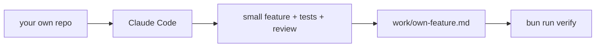

# Ship a feature in your own repo

## The problem

You have walked the whole lifecycle on Kestrel. The course world is safe, so it proves little. The real test is your own code.

A team that only practises on a sample repo often goes back to old habits on Monday. One small real feature, done with a spec, tests and a review, is the proof.



## Your challenge

Start the step. It adds an empty template to `kestrel/work/`:

```bash
bun run start ship-in-your-own-repo
```

Expect: `kestrel/ is ready at the start of ship-in-your-own-repo.`

Now leave `kestrel/`. Open Claude Code in your own repo and ship one small feature. Follow `solution/prompts.md` for the three prompts: pick a feature in plan mode, write the failing tests and build in small commits, then review in a fresh session.

Fill in `kestrel/work/own-feature.md` with real facts from your repo. Run `git log` there for the commit id, and paste the real test result.

```bash
bun run verify ship-in-your-own-repo
```

Expect: `Done. All 8 rules pass.`

## Done when

- Every heading in the template is filled in and no `TODO` is left.
- There are two acceptance lines, each with WHEN and THEN.
- The commit is a real id, the test command is named, and the result shows a count.
- No line talks about bikes, wrenches, crews or Kestrel.

## If you get stuck

| What you see                                | Fix                                                                       |
| ------------------------------------------- | ------------------------------------------------------------------------- |
| `FAIL the commit is a real id`              | Run `git log --oneline -1` in your repo and paste the short id.           |
| `FAIL no line comes from the course world`  | Describe your own repo. Take out any bike, wrench, crew or Kestrel words. |
| `FAIL the test result shows a count`        | Paste the line your test tool prints, such as `14 passed`.                |

## Words you will use

- **Acceptance line**: one sentence that says when the feature counts as done, in the form WHEN something happens THEN something results.
- **Evidence**: a fact anyone can look up again, such as a commit id.
