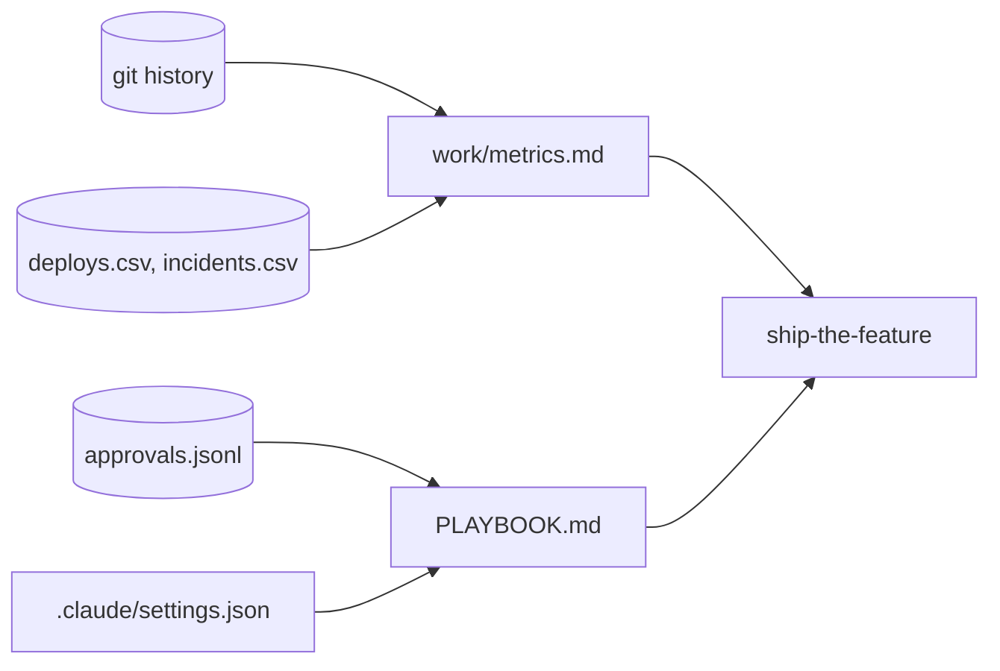

# Run the team

This part moves the **Outcome** and the **Goal**: the team's playbook, and the proof.

## The problem

The director asks whether the Claude Code seats paid off. Only the team's own numbers can answer that, read from its own git history and deploy log.

Doctolib reports "47% more pull requests per engineer" and "25% shorter change lead time" between January and September 2026 ([Doctolib](https://claude.com/customers/doctolib)). That is their number. This part measures yours.

For example, Kestrel's deploy log gives a change failure rate of 9 of 69 deploys, which is 13%.



| Step                      | Minutes | What the check reads                                                                                                                                                                                                                                                                                                                                              |
| ------------------------- | ------- | ----------------------------------------------------------------------------------------------------------------------------------------------------------------------------------------------------------------------------------------------------------------------------------------------------------------------------------------------------------------- |
| `measure-the-lifecycle`   | 20      | `work/metrics.md`: the four DORA keys from `deploys.csv` and `incidents.csv` (within 5%), and from git: intent to spec time, spec commits after the first plan commit, files changed outside `plan.md`, share of commits with the Claude Code trailer, median commit size (exact). Each number names its command. One sentence says what the numbers do not prove |
| `write-the-team-playbook` | 20      | `PLAYBOOK.md`: every gates row matches a role in `approvals.jsonl`, every never-do item matches a deny or ask rule, the size limit equals the one `build-in-small-slices` enforced. The em approval matches                                                                                                                                                       |
| `ship-the-feature`        | 10      | The Goal. Every AC id maps to a test, a green run, a commit, `plan.md` and the release note. Every approval hash matches and the gates came in order. The world contract passes. Every postmortem action item has a passing check. It walks `checks/lib/chain.ts`, like `bun run finished`                                                                        |

This part takes 50 minutes.

## Walkthrough

Each step starts where the step before it ended. To jump in here, make `kestrel/` the begin state of the first step:

```bash
bun run start measure-the-lifecycle
```

Expect: `kestrel/ is ready at the start of measure-the-lifecycle.`

Follow the step's README in Claude Code. Then check the numbers:

```bash
bun run verify measure-the-lifecycle
```

Expect: `Done. All 10 rules pass.`

Ask Claude Code to commit `work/metrics.md`. Then go on to `write-the-team-playbook`. Follow its README, then sign the playbook:

```bash
bun run approve PLAYBOOK.md --role em
```

Expect: `Approved PLAYBOOK.md as em`

```bash
bun run verify write-the-team-playbook
```

Expect: `Done. All 7 rules pass.`

Last, follow the README of `ship-the-feature`. This is the Goal of the course:

```bash
bun run verify ship-the-feature
```

Expect: `Done. All 10 rules pass.`

Check the whole part:

```bash
bun run verify part run-the-team
```

Expect: `Part run-the-team is done: 3/3 steps pass.`

For example, a passing part prints these lines:

```text
Part run-the-team:
  PASS   measure-the-lifecycle  (10/10 rules)
  PASS   write-the-team-playbook  (7/7 rules)
  PASS   ship-the-feature  (10/10 rules)
Part run-the-team is done: 3/3 steps pass.
```

To see the sample end state without a live Claude Code, run `bun run catch-up ship-the-feature`. Your old `kestrel/` moves to `.kestrel-backups/`.

## Assignment

"Did the seats pay off?" Hand in a pushed branch with `work/metrics.md`, `PLAYBOOK.md` with the em approval, and `CHAIN.md`.

| #   | Question                                                                        | Answered by                              |
| --- | ------------------------------------------------------------------------------- | ---------------------------------------- |
| 1   | Does `metrics.md` show each number with the command that produced it?           | `bun run verify measure-the-lifecycle`   |
| 2   | Do the DORA keys and git numbers match what the check counts?                   | `bun run verify measure-the-lifecycle`   |
| 3   | Does `PLAYBOOK.md` list a gate for each approval role actually used?            | `bun run verify write-the-team-playbook` |
| 4   | Is every Never do item a real deny or ask rule?                                 | `bun run verify write-the-team-playbook` |
| 5   | Does the whole chain hold: gates in order, AC to test to commit, small commits? | `bun run verify ship-the-feature`        |
| 6   | Does `CHAIN.md` state one thing the numbers do not prove?                       | a reader                                 |

Pass is 6 of 6.

**If you already know this:** turn on Claude Code's OpenTelemetry metrics. Put `claude_code.commit.count` next to the trailer share from git, and explain any gap.

## Finished

You now have the lifecycle chain. One feature went from a raw problem to production and back through an incident. Every stage left a file, and every file was signed. `work/metrics.md` shows your team's own numbers, each with its command. `PLAYBOOK.md` says how your team works, and the repo proves each line.

What comes next is your own backlog. Run the same chain on one real feature. Then `bun run verify ship-the-feature` asks the same questions of your work.
