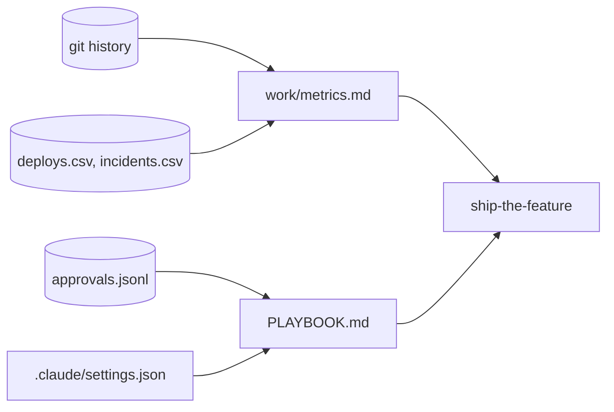

# Run the team

This part moves the **Outcome** and the **Goal**: the team's playbook, and the proof.

## The problem

The director asks whether the Claude Code seats paid off. Only the team's own numbers can answer that, read from its own git history and deploy log.

Doctolib reports "47% more pull requests per engineer" and "25% shorter change lead time" between January and September 2026 ([Doctolib](https://claude.com/customers/doctolib)). That is their number. This part measures yours.

For example, the finished chain's deploy log gives a change failure rate of 9 of 69 deploys, which is 13%.

| Step                      | Minutes | What the check reads                                                                                                                                                                                                                                                                                                                                              |
| ------------------------- | ------- | ----------------------------------------------------------------------------------------------------------------------------------------------------------------------------------------------------------------------------------------------------------------------------------------------------------------------------------------------------------------- |
| `measure-the-lifecycle`   | 20      | `work/metrics.md`: the four DORA keys from `deploys.csv` and `incidents.csv` (within 5%), and from git: intent to spec time, spec commits after the first plan commit, files changed outside `plan.md`, share of commits with the Claude Code trailer, median commit size (exact). Each number names its command. One sentence says what the numbers do not prove |
| `write-the-team-playbook` | 20      | `PLAYBOOK.md`: every gates row matches a role in `approvals.jsonl`, every never-do item matches a deny or ask rule, the size limit equals the one `build-in-small-slices` enforced. The em approval matches                                                                                                                                                       |
| `ship-the-feature`        | 10      | The Goal. Every AC id maps to a test, a green run, a commit, `plan.md` and the release note. Every approval hash matches and the gates came in order. The world contract passes. Every postmortem action item has a passing check. It walks `checks/lib/chain.ts`, like `bun run finished`                                                                        |

This part takes 50 minutes.

## Walkthrough

TODO(part session): one command per step, each followed by its `Expect:` line. Build each step's folder with `problem/`, `solution/` and `prompts.md`, and `wrong/`, as `parts/01-ready-the-repo/` does.
