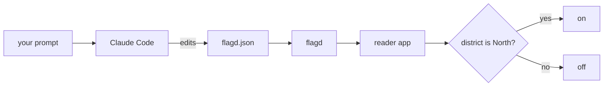

# Roll out with OpenFeature

## The problem

Your rollout plan sends a change to one district first. Today that plan is a file a person must follow. A flag makes the plan a rule that the code obeys.

OpenFeature is the standard way for code to ask for a flag. flagd is a small server that answers from a JSON file. A rule in the file says which users get the change, and the reader app picks up an edit with no restart.

For example, the rule "district is North" turns the change on for North riders and leaves East off.



## Your challenge

Start the step:

```bash
bun run start roll-out-with-openfeature
```

Expect: `kestrel/ is ready at the start of roll-out-with-openfeature.`

Open Claude Code. Ask it to read `work/rollout.yaml` and name the first district. Then ask it to edit only `assignment/flags/flagd.json`, so the flag `wrench_disables_bike` is on for that district and off for everyone else. Ask to see the diff before it saves.

Write `assignment/CHOICE.md` yourself. Give a Choose when line and a Trade-off line for a flag UI. Save your prompts in `assignment/prompts.md`.

Check your work:

```bash
bun run verify roll-out-with-openfeature
```

Expect: `Done. All 6 rules pass.`

To see the change live, follow `assignment/README.md`. That path needs Docker.

## Done when

- `assignment/flags/flagd.json` keeps the flag off by default.
- A user in the first district of the plan reads on.
- A user in another district still reads off.
- `assignment/CHOICE.md` and `assignment/prompts.md` exist.

## If you get stuck

- If the check says the flag file is missing, you ran it before `bun run start`. Run the start command first.
- If everyone reads on, the default variant is on. Set it back to off.
- If nobody reads on, check that the district in the rule matches the first stage in `work/rollout.yaml`.

## Words you will use

- **Feature flag:** a switch in a file that turns a change on for chosen users.
- **flagd:** a small open-source server that serves flags from a file.
- **OpenFeature:** the standard way for code to ask for a flag, whichever server answers.
- **Targeting:** the rule in the flag file that picks which users get the change.
- **Variant:** one value a flag can have, here `on` or `off`.
