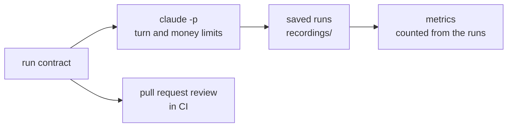

# Run it without you

## The problem

Some runs should happen with nobody there: a check each morning, a review on every pull request. A run with no limit can spend money all night or edit the wrong file. So it needs a contract, and numbers to show it still works.

For example, a morning run that only runs `bun test` and reports the count is safe, cheap and easy to measure.



## Your challenge

Start the step:

```bash
bun run start run-it-without-you
```

Expect: `kestrel/ is ready at the start of run-it-without-you.`

1. Run Claude Code headless, twice, and save each run. Headless means no person types: the `-p` flag gives it one prompt and it prints the result. Make the folder first:

```bash
mkdir -p recordings/run-it-without-you
```

Expect: no output.

```bash
claude -p "Run bun test in this folder and tell me, in one sentence, how many tests pass and how many fail. Do not edit any file." --output-format stream-json --verbose --max-turns 6 --max-budget-usd 0.5 --allowedTools "Bash(bun test*)" > recordings/run-it-without-you/run-1.jsonl
```

Expect: the file `recordings/run-it-without-you/run-1.jsonl` has a last line with `"type":"result"`. Run it again, and save the second as `run-2.jsonl`.

2. Open `work/unattended.md`. Write the command you ran under Command. Under Loop, write a `/loop` line: it repeats a check on an interval while your session is open. Under Schedule, write a `/schedule` line: it runs a check on a timetable, even when you are away.
3. Fill the Run contract. Stop when must name a command in backticks that proves the work is done.
4. Fill the Metrics from your saved runs. Open each result line and read `total_cost_usd` and `num_turns`. Write the mean of each. Do not guess: the check counts them again.
5. Ask Claude Code to write `work/review-action.yml`, a GitHub Actions workflow that reviews each pull request. It must run on `pull_request`, read contents only, set a timeout and take its key from `secrets`. Never type a key into the file. Copy it to `.github/workflows/` in your own repo when you are ready.

```bash
bun run verify run-it-without-you
```

Expect: `Done. All 9 rules pass.`

## Done when

- The Command uses `claude -p` with limits, and two saved runs stayed inside them.
- Loop and Schedule each have a line with a time.
- The run contract is complete, and its stop condition is a command.
- The metrics match the saved runs.
- The workflow runs on pull requests, reads contents only, has a timeout and uses `secrets`.

## If you get stuck

| What you see                                | Fix                                                                         |
| ------------------------------------------- | --------------------------------------------------------------------------- |
| "FAIL the metrics match the saved runs"     | Read the numbers from the result line of each run, then average them.       |
| "FAIL the workflow reads contents only ..." | Add a timeout to each job and take the key from `secrets`, never from text. |
| "FAIL 2 or more saved runs finished ..."    | Run the command twice and save each run in its own file.                    |

## Words you will use

- **Headless**: Claude Code with no person at the keyboard, started with `claude -p`.
- **Run contract**: the goal, the stop condition, the budget and the allowed tools for one run.
- **Loop**: a prompt that repeats on an interval while your session is open.
- **Schedule**: a prompt that runs on a timetable without your session.
