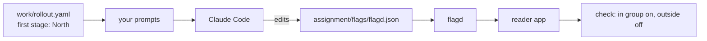

# Roll out a change slowly with OpenFeature

This part moves the **Outcome**: the rollout stage of the lifecycle chain, run by the tool teams use in production.

## The problem

In `gate-the-release` you wrote a rollout plan by hand. It sends a change to one district first and stops if a guardrail is crossed. A plan in a file only works if someone follows it.

A feature flag turns the plan into a switch. The code asks "is this on for this user?" and a flag file answers. Changing who sees the feature is then a one-line edit, with no new deploy.

## Why it matters

Google's DORA research tracks the share of deploys that fail. A change that reaches one district first fails small. A change that reaches everyone at once fails everywhere. The flag is also the rollback: switch it off and the change is gone.

For example, Kestrel's plan starts in North. With a flag, "North only" is a rule in one file, and every other district stays off.

## What we teach

OpenFeature is a standard API for asking a flag question. flagd is a small open-source server that answers it from a file. You keep the hand-built plan. You redo its first stage as a flag, with Claude Code making the edit.



| Step                        | Minutes | What the check reads                                                                                                                                                                |
| --------------------------- | ------- | ----------------------------------------------------------------------------------------------------------------------------------------------------------------------------------- |
| `roll-out-with-openfeature` | 25      | `assignment/flags/flagd.json`: the flag is enabled and off by default, a user in North reads on, a user outside reads off. `assignment/CHOICE.md` and `assignment/prompts.md` exist |

This part fits in one sitting. It is optional in the live session and expected as homework.

## Walkthrough

```bash
bun run start roll-out-with-openfeature
```

Expect: `kestrel/ is ready at the start of roll-out-with-openfeature.`

Follow the step's README in Claude Code. Then check your flag file:

```bash
bun run verify roll-out-with-openfeature
```

Expect: `Done. All 6 rules pass.`

Check the whole part:

```bash
bun run verify part roll-out-a-change-slowly
```

Expect: `Part roll-out-a-change-slowly is done: 1/1 steps pass.`

The live version, with the containers, is in `assignment/README.md`.

## Options

Unleash is the runner-up. It is an open-source flag server with a web UI.

- **Choose when:** the team wants a flag UI and an audit log, so people who do not edit files can change a rollout.
- **Trade-off:** it is one more server and one more database to run.

Your code does not change if you switch. OpenFeature is the API, and the server behind it is a provider.

## Finished

One flag, served by flagd, now does what the first stage of your rollout plan did by hand. The earlier parts are unchanged.

## Watch and read

| Kind  | Title                                     | Author                                 | Why                                                                       | Link                                                     |
| ----- | ----------------------------------------- | -------------------------------------- | ------------------------------------------------------------------------- | -------------------------------------------------------- |
| video | Type-safe feature flagging in OpenFeature | Google engineers, at KubeCon           | Lessons from running flags at a large company.                            | <https://youtu.be/mewXGSwDCE4>                           |
| video | Claude Code best practices                | Anthropic, talk at its developer event | The team shows CLAUDE.md, permissions, tools and planning in one sitting. | <https://www.youtube.com/watch?v=gv0WHhKelSE>            |
| read  | OpenFeature documentation                 | OpenFeature project                    | The standard this step uses.                                              | <https://openfeature.dev/docs/reference/intro>           |
| read  | Feature toggles                           | Martin Fowler                          | The classic guide to the kinds of flag.                                   | <https://martinfowler.com/articles/feature-toggles.html> |
| read  | Embracing risk                            | Google SRE Book                        | Why a small, slow rollout spends less error budget.                       | <https://sre.google/sre-book/embracing-risk/>            |
